# 1. Введение

##  1.1 Задание
-   Создать 2 виртуальные машины:
    * одна - сервер, ПО Windows Server 2012 R2 Standar (with GUI)
    * вторая - клиент, ПО Windows10 Pro;
-   На сервере развернуть службу Active Directory Domain Services (AD DS) и создать новый домен по шаблону `фамилия.local`.
-   Создать пользователя;
-   Обеспечить crossping между сервером и хостом по их доменным именам
-   Настроить выдачу ip по шаблону `10.группа.№ в списке.№ произвольный`
    
##  1.2 Алгоритм выполнения
-   Создание и базовая настройка виртуальных машин.
-   Настройка сетевых интерфейсов Windows Server
    *   LAN 10.74.16.0
    *   WAN 172.74.16.0 
-   Установка и настройка Active Directory Domain Services.
-   Для взаимодйествия виртуальныхм машин наиболее логичным будет дополнительно настроить на сервере
    *   DHCP - чтобы автоматически выдавать ip клиентам по обозначенному шаблону
    *   DNS - автоматически устанавливается с AD DS 
    *   RA  - для настройки маршрутизации
-   Настройка клиентской машины Windows 10.
-   Подключение клиента к домену.
-   Проверка работы DNS, DHCP, маршрутизации и NAT.
-   Проверка сетевого взаимодействия между клиентом и сервером `crossping`
    
# 2. Конфигурация виртуальных машин

## 2.1. Конфигурация сервера
-   ОС - Windows Server 2012 R2 Standard (with GUI)
-   Оперативная память - 3000 мБ;
-   Число ЦПУ - 2;
-   Носитель - динамически расширяемый виртуальный диск объемом 50 Гб;
-   Сетевой адаптер 1 - NAT сеть;
-   Сетевой адаптер 2 - внутренняя сеть;

## 2.1. Конфигурация клиентской машины
-   ОС - Windows 10 Pro (есть возможность изменять домен)
-   Оперативная память - 3000 мБ;
-   Число ЦПУ - 2;
-   Носитель - динамически расширяемый виртуальный диск объемом 35 Гб;
-   Сетевой адаптер 1 - внутренняя сеть.
    
# 3. Настройка Windows Server 2012 R2

## 3.1. Изменение имени сервера
Переименовываем сервер, в удобное для восприятия название, и перезагружаемся 

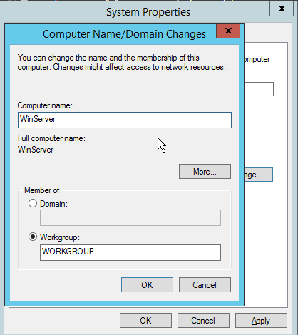

## 3.2. Настройка сетевых интерфейсов
Для определения текущих параметров сетевых интерфейсов используется команда: `ipconfig`

Результат выполнения команды представлен на рисунке.

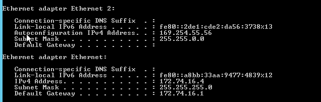

В системе присутствуют два сетевых интерфейса:

* `Ethernet 1` — интерфейс, подключённый к NAT Network;
* `Ethernet 2` — интерфейс, подключённый к Internal Network.

Изначально интерфейс внутренней сети получил автоматически сгенерированный адрес `169.254.55.56`. Для организации локальной сети ему назначается статический IP-адрес в соответсвии с шаблоном: `10.74.16.1`

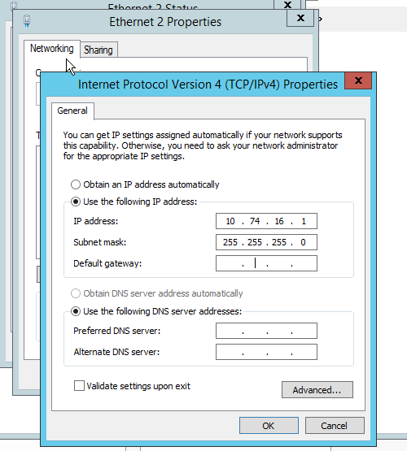

Шлюз по умолчанию для данного интерфейса не указывается, поскольку внутренняя сеть предназначена для локального взаимодействия между сервером и клиентом.

Интерфейс, подключённый к NAT Network, имеет IP-адрес: `172.74.16.4`

и использует шлюз:  `172.74.16.1`

Данный интерфейс предназначен для связи сервера с внешней сетью.

Для упрощения дальнейшей настройки сетевые интерфейсы переименовываются:

* `Ethernet 1` --> `WAN`;
* `Ethernet 2` --> `LAN`.

После выполнения настройки параметры сетевых интерфейсов имеют следующий вид.

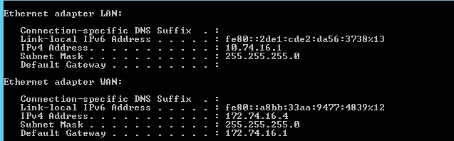

# 4. Развертывание Active Directory Domain Services

## 4.1. Установка роли AD DS

Для развертывания доменной инфраструктуры на сервер устанавливается роль `Active Directory Domain Services`.

Установка выполняется через меню:   `Manage --> Add Roles and Features`

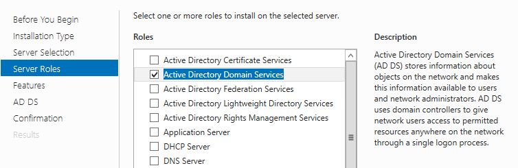

На последующих этапах мастера установки основные параметры оставляются без изменений.

После установки роли выполняется настройка нового леса Active Directory. В разделе `Deployment Configuration` выбирается пункт создания нового леса.

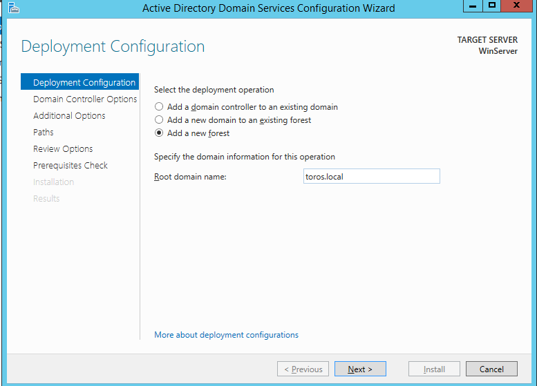

В качестве имени корневого домена указывается:  `toros.local`

Остальные параметры конфигурации оставляются установленными по умолчанию. Делегирование DNS не выполняется, поскольку DNS-сервер будет работать непосредственно на контроллере домена.

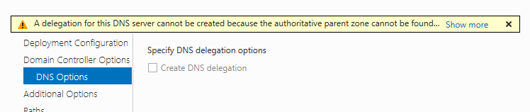

После завершения установки выполняется перезагрузка сервера.

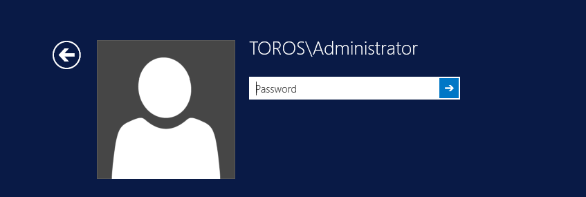

В результате сервер становится контроллером домена `toros.local`.

# 5. Настройка DNS

## 5.1. Создание зоны обратного просмотра

После установки Active Directory выполняется настройка DNS-сервера.

Для этого используется средство `DNS Manager`, доступное через:   `Manage --> Tools --> DNS`

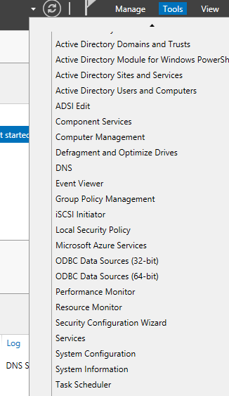

Для обеспечения возможности определения доменного имени по IP-адресу создаётся зона обратного просмотра `Reverse Lookup Zone`.

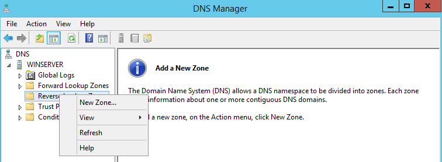

В мастере создания зоны применяем настройки по умолчанию

* Primary zone;
* to all DNS ... in this domain;
* IPv4 Reverse Lookup Zone.

И назначаем ID сети, соответсвующий LAN

В качестве идентификатора сети указывается: `10.74.16.0`

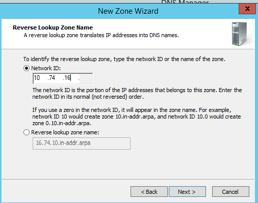

## 5.2. Проверка разрешения DNS-имён

После создания зоны выполняется проверка корректности работы DNS с помощью утилиты `nslookup`.

После чего в зоне обратной видимости через PTR добавляется запись:

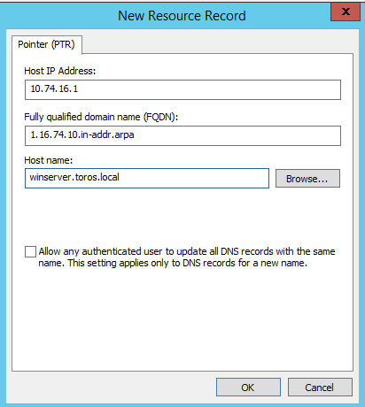 

После добавления записи выполняется повторная проверка разрешения IP-адреса в доменное имя.

Таким образом, используются два типа DNS-зон:

-   Forward Lookup Zone предназначена для сопоставления доменного имени с IP-адресом.

-   Reverse Lookup Zone предназначена для сопоставления IP-адреса с доменным именем.

# 6. Настройка DHCP-сервера

## 6.1. Установка роли DHCP

Для автоматической выдачи клиентам сетевых параметров на сервер устанавливается роль `DHCP Server`.

Установка выполняется с использованием стандартного мастера добавления ролей. Основные параметры мастера оставляются без изменений.

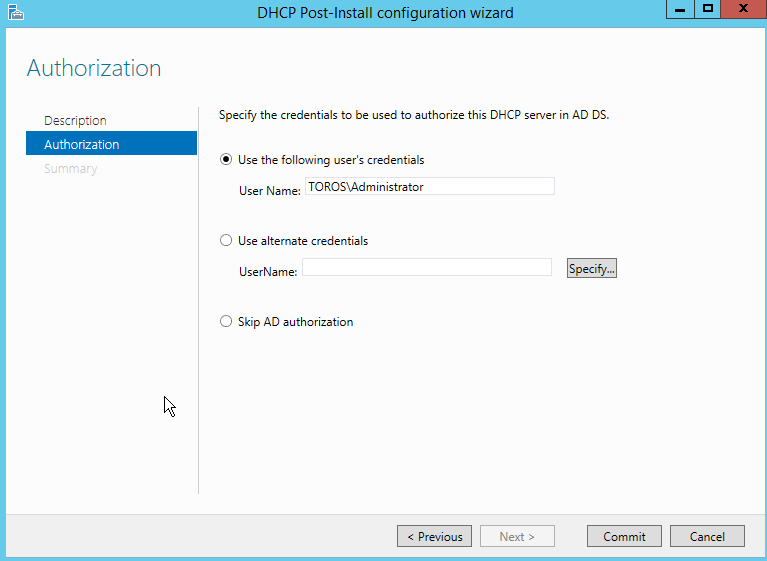

## 6.2. Создание DHCP-области

После установки DHCP создаётся новая область адресов.

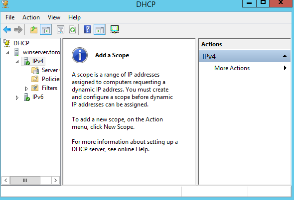

Области присваивается имя:  `local_net_address`

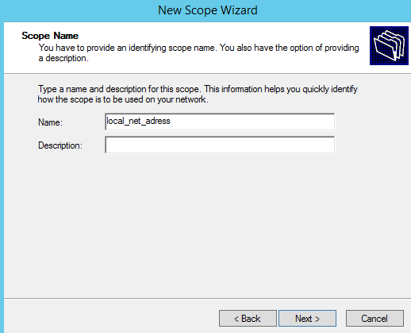

При настройке диапазона адресов несколько начальных адресов резервируются на будущее.

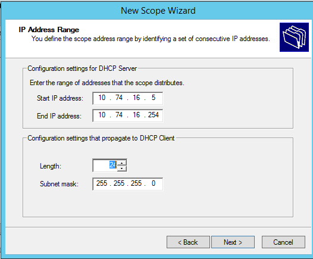

В параметрах DHCP-области задаётся шлюз по умолчанию.

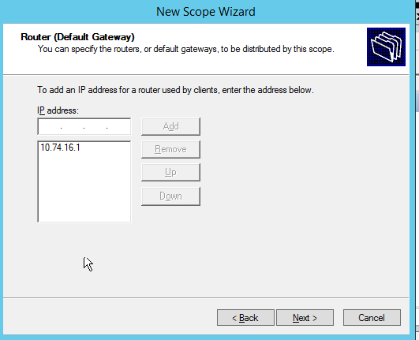

Параметры родительского домена и DNS-сервера оставляются без изменений.

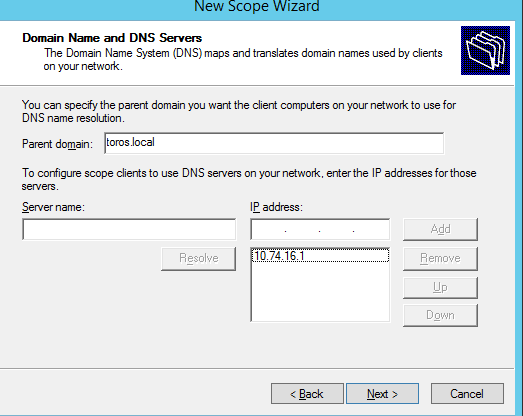

Настройка WINS-сервера не выполняется, т.к NetBIOS не используется.

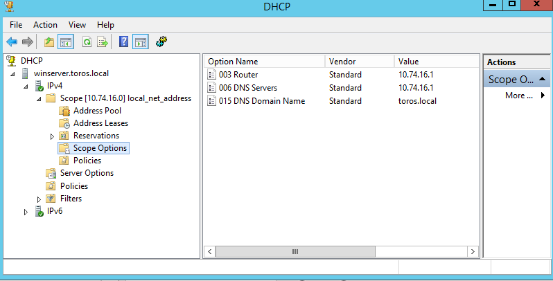

# 7. Настройка маршрутизации и NAT

## 7.1. Установка роли маршрутизации

Для обеспечения маршрутизации трафика между внутренней и внешней сетями устанавливается роль `Remote Access` с компонентом `Routing`.

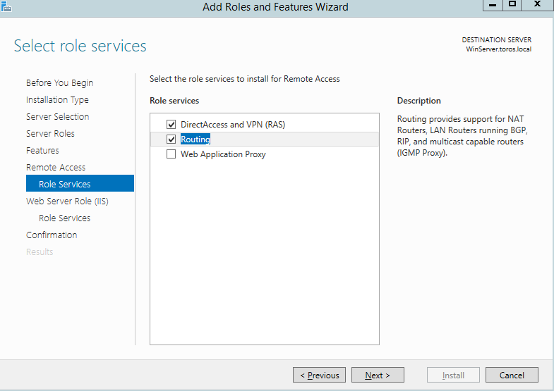

После установки открывается консоль `Routing and Remote Access`.

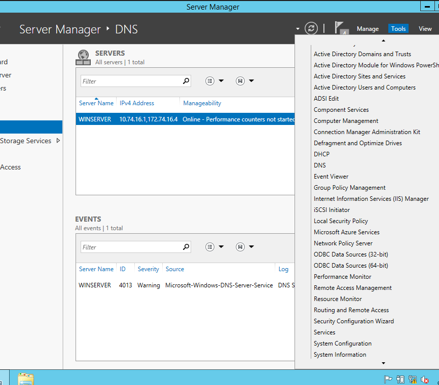

Запускается мастер настройки службы маршрутизации.

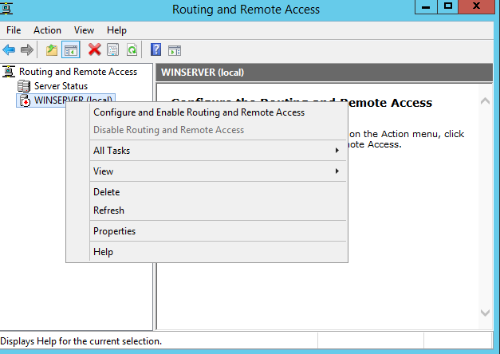

В качестве типа конфигурации выбирается `Custom configuration`.

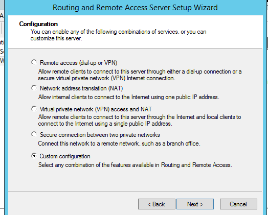

В составе пользовательской конфигурации включаются:

-   NAT;
-   LAN routing.

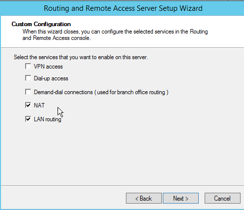

После завершения настройки служба маршрутизации запускается.

## 7.2. Настройка NAT

Для предоставления клиентам доступа во внешнюю сеть выполняется настройка NAT для интерфейса `WAN`.

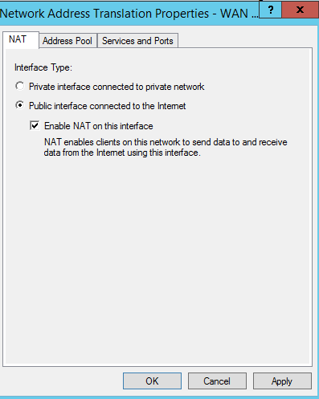

В результате сервер выполняет функции маршрутизатора между двумя сетями:

-   LAN:  10.74.16.0/24
-   WAN:  172.74.16.0/24

Трафик от клиентов внутренней сети передаётся через сервер, после чего посредством NAT направляется во внешнюю сеть.

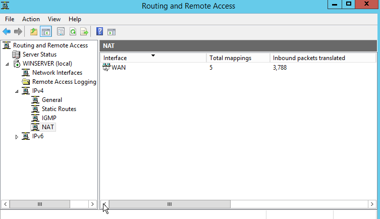

# 8. Создание пользователя домена

В домене `toros.local` в стандартном контейнере `Users` создаётся пользователь, предназначенный для последующего входа на клиентскую машину.

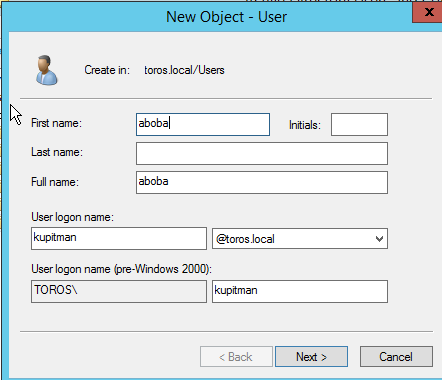

В свойствах созданной учётной записи отключается требование обязательной смены пароля при первом входе для удобства.

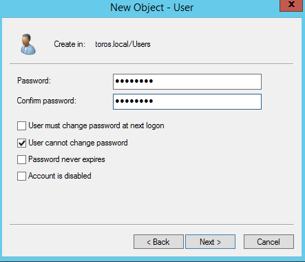

Созданная учётная запись используется для авторизации на клиентском компьютере после его присоединения к домену.

# 9. Подключение Windows 10 к домену

После завершения настройки серверной инфраструктуры выполняется настройка клиентской машины под управлением Windows 10 Pro.

Клиент подключается к внутренней сети и получает необходимые параметры сетевой конфигурации от DHCP-сервера.

Далее выполняется проверка возможности подключения компьютера к домену.

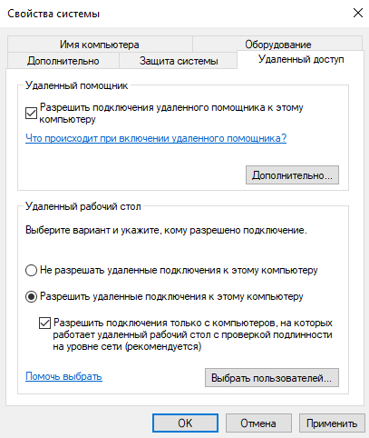

В качестве домена указывается:  `toros.local`

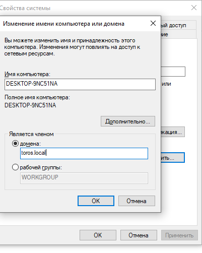

Для подтверждения подключения используются учётные данные ранее созданного пользователя домена.

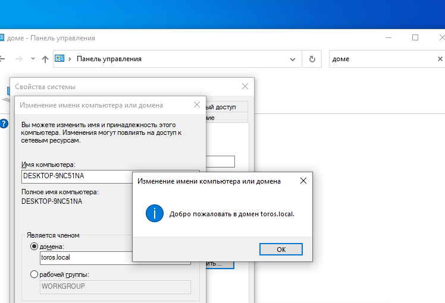

После успешного присоединения к домену выполняется перезагрузка клиентского компьютера.

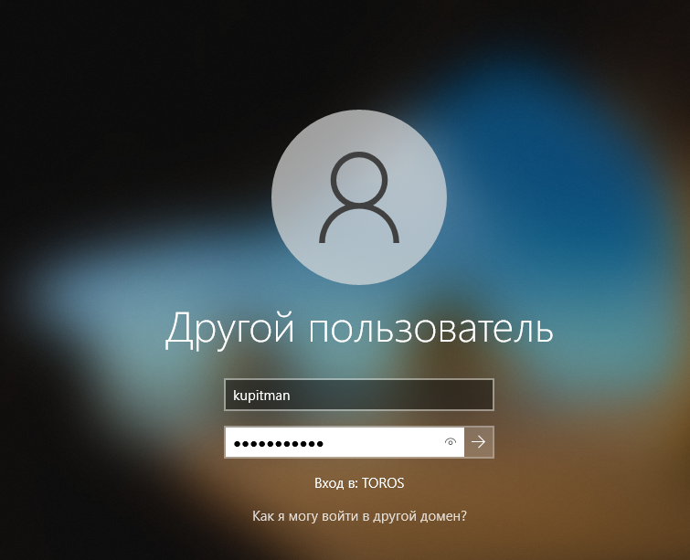

После перезагрузки осуществляется вход с использованием доменной учётной записи.

# 10. Проверка работоспособности системы

## 10.1. Проверка доступнусто сервера со стороны клиента

Для проверки доступности сервера, отправляется ICMP запрос по его доменному имени

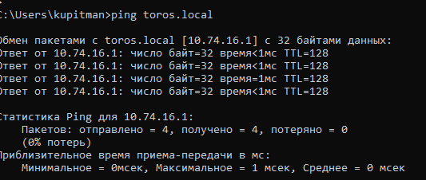

Затем проверяется доступ клиента во внешнюю сеть.

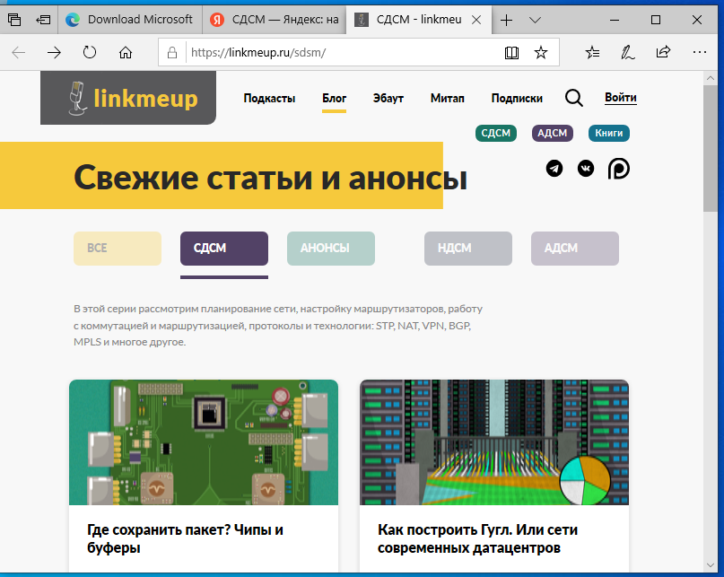

Успешное подключение подтверждает корректную работу маршрутизации и NAT на сервере.

## 10.2.1 Проверка доступнусто клиента со стороны сервера

Для проверки доступности клиента, отправляется ICMP запрос, на который не приходит ответ. Дело в том, что к пользователю по умолчанию применяется GPO, которая не позволяет отвечать на ICMP

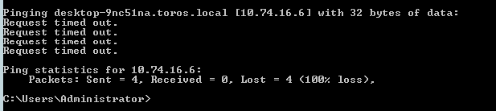

Правильным решением будет создать `Organization Unit` , добавить в него пользователя и пк, после чего применить к ним GPO с разрешенным ICMP

## 10.2.2 Создание OU

Заходим в конфигуратор политик по пути:

`Server Manager --> Tools --> Active Directory Users and Computers`

И создаем новый OU `ICMP_friends`

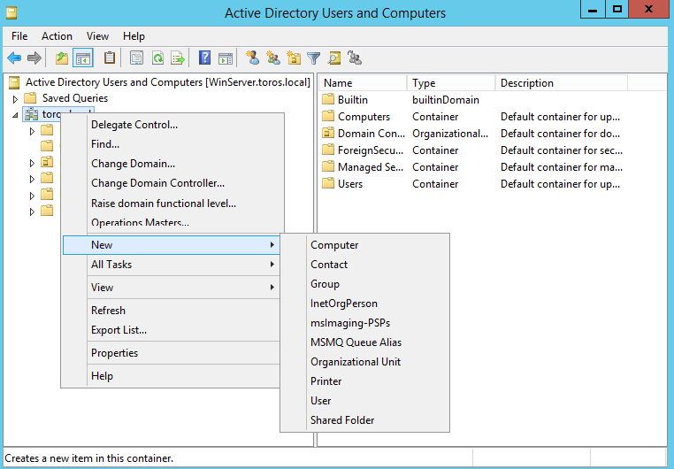

Затем перемещаем в него компьютер и пользователя

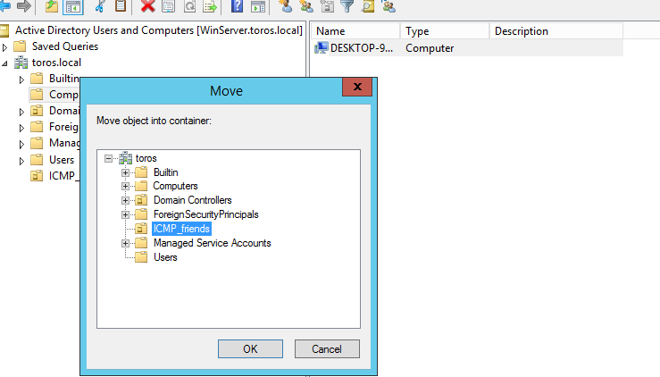
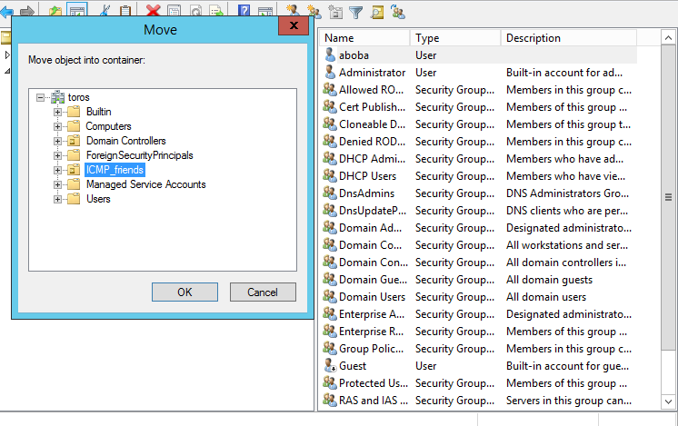

## 10.2.3 Создание GPO

Заходим в конфигуратор политик по пути:

`Server Manager --> Tools --> Group Policy Management`

И создаем новую политику в OU под названием `Allow ICMP`
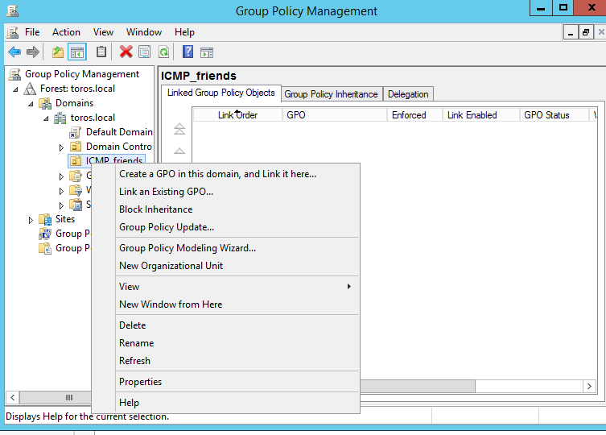

Затем через редактирование идем в 

`Computer Configuration --> Policies --> Windows Settings --> Security Settings --> Windows Firewall with Advanced Security --> Inbound Rules`
    
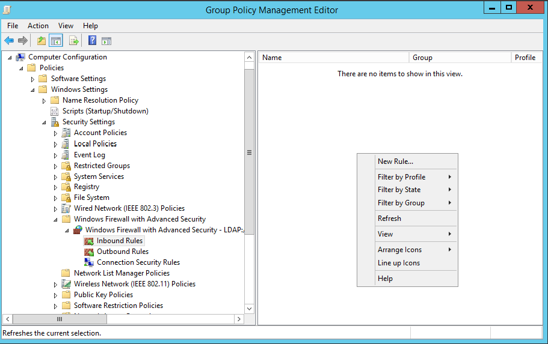

В мастере выбираем:
-   Custom All Programs 
-   Protocol type
-   ICMPv4
-   Any IP address
-   Allow the connection
-   Domain Private Public   
-   `Allow ICMP` - название правила

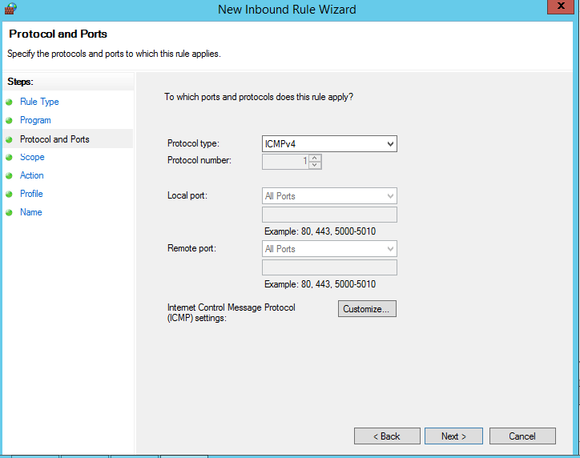
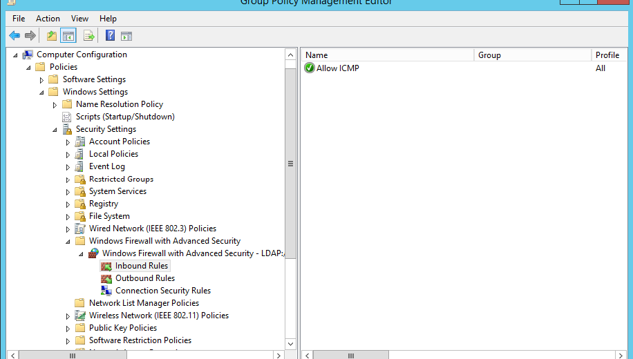

Обновляем политики на клиенте через команду `gpudate /force`

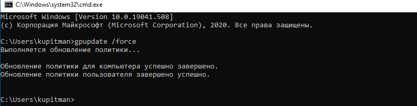

## 10.2.4 Проверка доступности с новой политикой

После применеия политики, получаем предсказуемый результат:

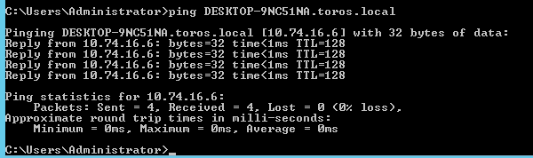

# 10.2.5 Итоговый crossping

# 11. Схема сети

[Схема сети](Документ1.vsdx)

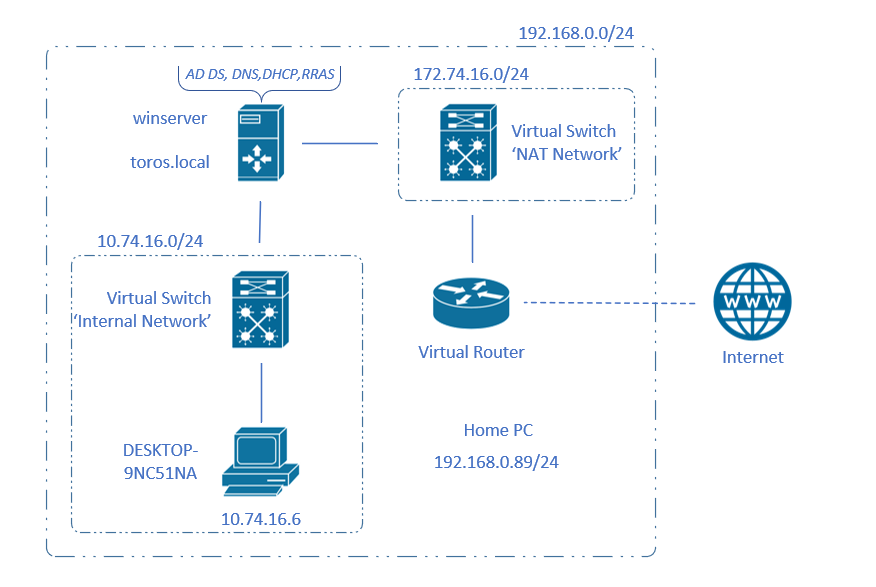

https://vecta.io/symbols/240/cisco-network-topology-icons-3015  - ссылка на пак иконок