# 5.1. Практическое исследование исходной конфигурации аудита и журналирования Windows Server 2012 R2

## 5.1.2. Фиксация исходного состояния контроллера домена

Создать каталоги:

```cmd
mkdir C:\AuditResearch
mkdir C:\AuditResearch\Baseline
mkdir C:\AuditResearch\Baseline\Logs
mkdir C:\AuditResearch\Baseline\Exports
```
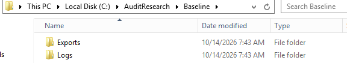

Сохранить сведения о системе:

```cmd
systeminfo > C:\AuditResearch\Baseline\systeminfo.txt
hostname >> C:\AuditResearch\Baseline\systeminfo.txt
ipconfig /all > C:\AuditResearch\Baseline\ipconfig.txt
route print > C:\AuditResearch\Baseline\routes.txt
```
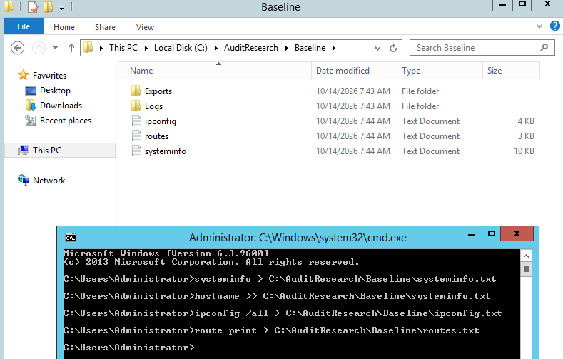

Сохранить состояние служб (Service Control):

```cmd
sc query NTDS >> C:\AuditResearch\Baseline\services.txt & sc query DNS >> C:\AuditResearch\Baseline\services.txt & sc query DHCPServer >> C:\AuditResearch\Baseline\services.txt & sc query RemoteAccess >> C:\AuditResearch\Baseline\services.txt & sc query SharedAccess >> C:\AuditResearch\Baseline\services.txt & sc query LanmanServer >> C:\AuditResearch\Baseline\services.txt & sc query LanmanWorkstation >> C:\AuditResearch\Baseline\services.txt & sc query EventLog >> C:\AuditResearch\Baseline\services.txt & sc query mpssvc >> C:\AuditResearch\Baseline\services.txt & sc query Winmgmt >> C:\AuditResearch\Baseline\services.txt
```
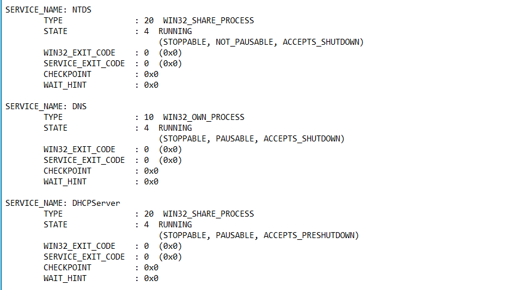
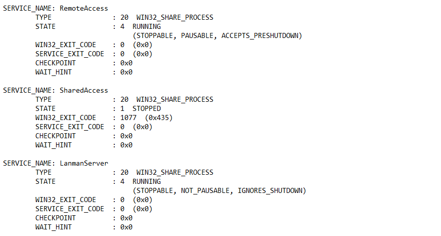
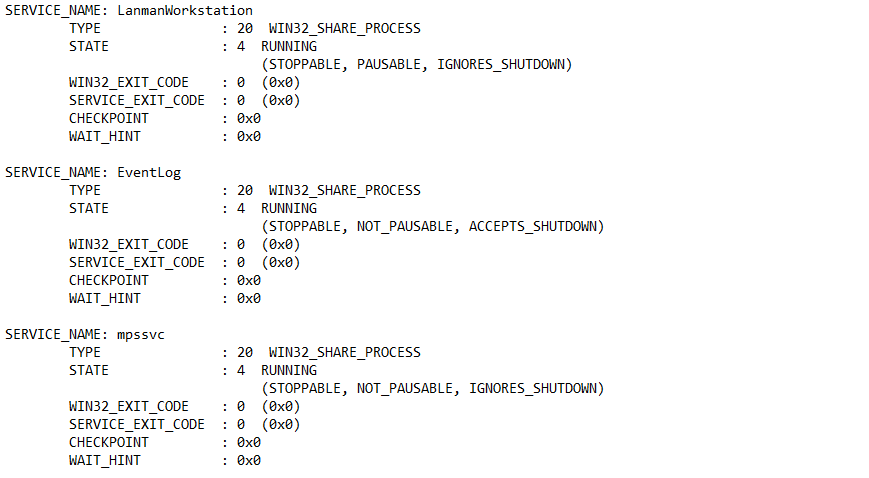
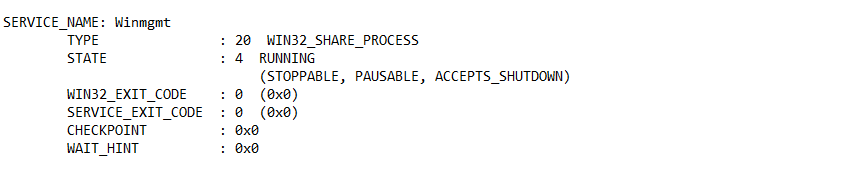
Зафиксировать состояние межсетевого экрана (Net Shell):

```cmd
netsh advfirewall show allprofiles > C:\AuditResearch\Baseline\firewall_profiles.txt
netsh advfirewall firewall show rule name=all > C:\AuditResearch\Baseline\firewall_rules.txt
```
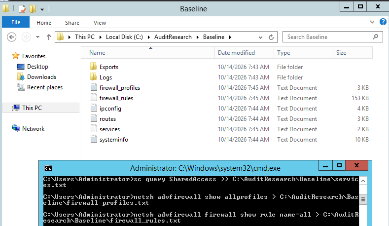
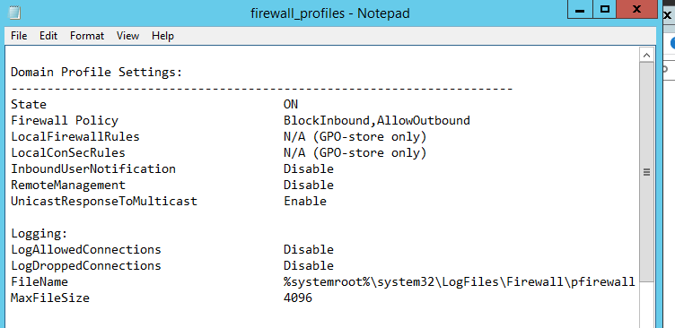
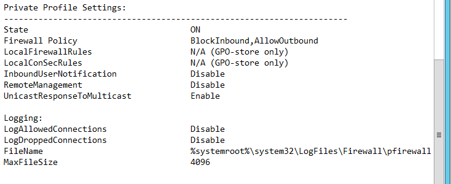
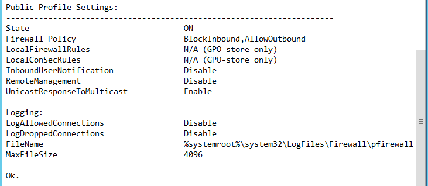

правила, пожалуй, не будем прикреплять, ввиду их большого объема

Проверить NAT и RRAS:

```cmd
netsh routing ip nat show interface > C:\AuditResearch\Baseline\nat_interfaces.txt
```
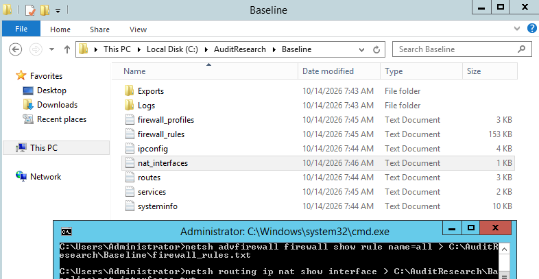
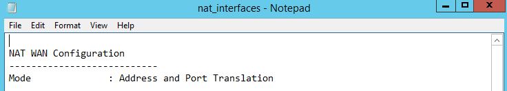

Свободное место (Windows Management Instrumentation Command line.):

```cmd
wmic logicaldisk where "DeviceID='C:'" get DeviceID,Size,FreeSpace
```
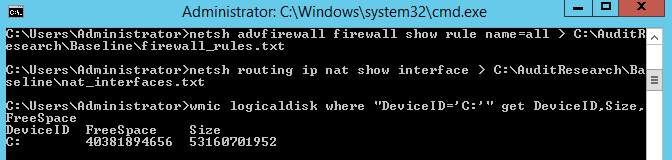

Результаты:

| Показатель | Значение |
|---|---|
| Имя сервера | WINSERVER |
| Домен | toros.local |
| ОС | Windows Server 2012 R2 Standard |
| Внутренний IP | 10.74.16.1 |
| Внешний IP | 172.74.16.4 |
| NTDS | RUNNING |
| DNS | RUNNING |
| DHCP | RUNNING |
| RRAS / RemoteAccess | RUNNING |
| NAT | RUNNING |
| SMB Server (LanmanServer) | RUNNING |
| SMB Client (LanmanWorkstation) | RUNNING |
| Windows Event Log (EventLog) | RUNNING |
| Windows Firewall (mpssvc) | RUNNING |
| WMI (Winmgmt) | RUNNING |
| SharedAccess (ICS/NAT) | STOPPED (код 1077 — служба не запускалась) |
| ОЗУ, Мбайт | 3000 |
| Свободно до эксперимента, байт | 4038194656 |

---

## 5.1.3. Сохранение исходной политики аудита

Audit Policy 
Group Policy Result 
Windows Event Utility / Enumerate Logs - получаем все журналы, которые есть

```cmd
auditpol /get /category:* > C:\AuditResearch\Baseline\audit_policy.txt
auditpol /backup /file:C:\AuditResearch\Baseline\audit_policy_backup.csv
gpresult /h C:\AuditResearch\Baseline\gpresult.html
wevtutil el > C:\AuditResearch\Baseline\event_channels.txt
```

получаем все активные журанлы 
```powershell
Get-WinEvent -ListLog * | Where-Object IsEnabled | Select-Object -ExpandProperty LogName > C:\AuditResearch\Baseline\activated_event_channels.txt
```

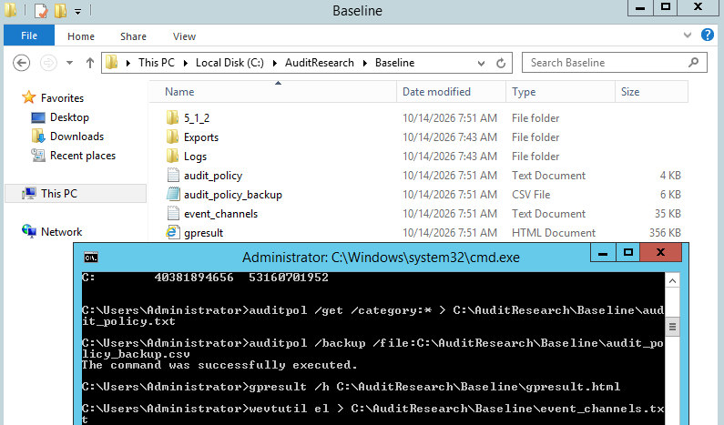
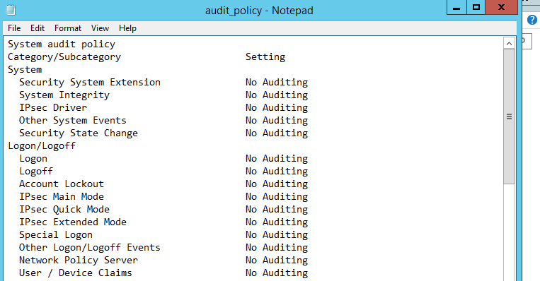
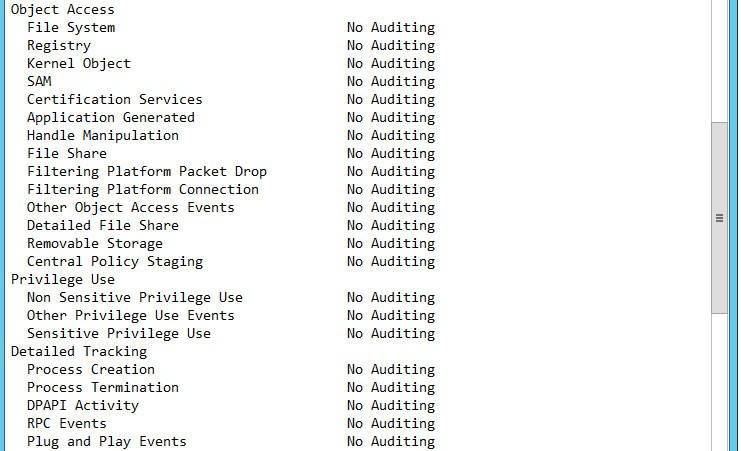
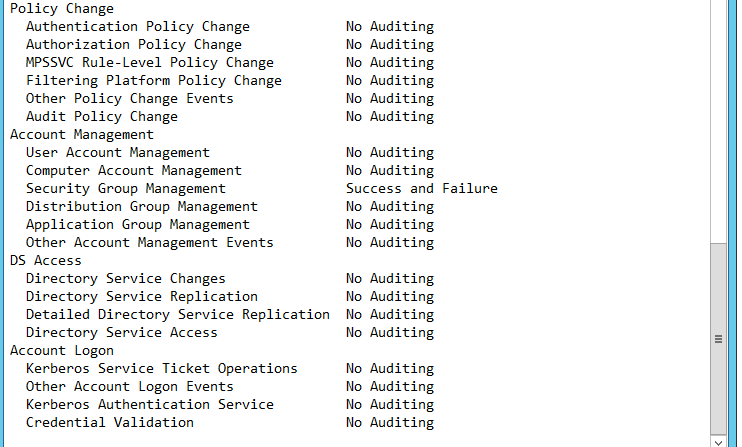

event_channels не будем выводить

---

## 5.1.4. Инвентаризация журналов событий

```powershell
Get-WinEvent -ListLog * |
Where-Object IsEnabled |
Select-Object LogName, RecordCount, FileSize, MaximumSizeInBytes |
Export-Csv C:\AuditResearch\Baseline\enabled_channels.csv -NoTypeInformation -Encoding UTF8
```

Размеры файлов `.evtx`:

```cmd
dir C:\Windows\System32\winevt\Logs\*.evtx > C:\AuditResearch\Baseline\evtx_sizes.txt
```
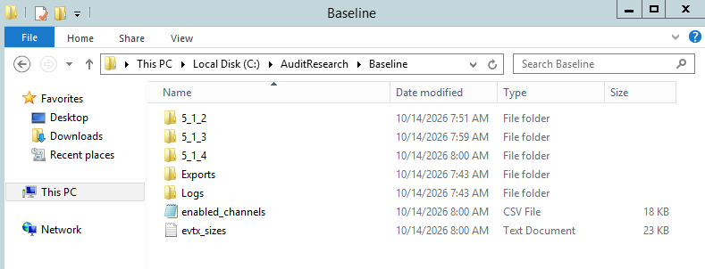

| Журнал | Макс. размер, байт | Факт. размер, байт |
|---|---:|---:|
| Security | 134 217 728 | 6 361 088 |
| System | 20 971 520 | 2 166 784 |
| Application | 20 971 520 | 1 118 208 |
| Directory Service | 1 052 672 | 1 052 672 |
| Microsoft-Windows-GroupPolicy/Operational | 4 194 304 | 4 198 400 |
| DNS Server | 104 857 600 | 1 118 208 |
| Microsoft-Windows-DNSServer/Audit | 104 857 600 | 1 118 208 |
| Microsoft-Windows-Dhcp-Server/AuditLog | нет данных | нет данных |
| Microsoft-Windows-Dhcp-Server/Operational | 1 052 672 | 69 632 |
| Microsoft-Windows-RemoteAccess-RemoteAccessServer/Operational | 1 052 672 | 69 632 |
| Microsoft-Windows-RemoteAccess-RemoteAccessServer/Admin | 1 052 672 | 69 632 |
| Microsoft-Windows-RasRoutingProtocols/Operational | 1 052 672 | 69 632 |
| Microsoft-Windows-WFP/Operational | 1 052 672 | 69 632 |
| Microsoft-Windows-Windows Firewall With Advanced Security/Firewall | 1 052 672 | 1 052 672 |
| Microsoft-Windows-NTLM/Operational | 1 052 672 | 69 632 |
| Microsoft-Windows-SMBServer/Operational | 8 388 608 | 1 118 208 |
| Microsoft-Windows-SMBServer/Security | 8 388 608 | 69 632 |
| Microsoft-Windows-SMBServer/Audit | 8 388 608 | 69 632 |
| Microsoft-Windows-SMBClient/Operational | 8 388 608 | 69 632 |
| Microsoft-Windows-SMBClient/Security | 8 388 608 | 69 632 |
| Microsoft-Windows-PowerShell/Operational | 15 728 640 | 5 312 512 |
| Microsoft-Windows-TaskScheduler/Operational | 10 485 760 | 2 166 784 |

### Примечания
**`Microsoft-Windows-SMBServer/Audit`**, **`SMBClient/Operational`**, **`SMBClient/Security`**, **`NTLM/Operational`**, **`WFP/Operational`**, **`RemoteAccess/Admin`**, **`RemoteAccess/Operational`**, **`RasRoutingProtocols/Operational`** — во всех `RecordCount = 0`, факт. размер = 69 632 (минимальный файл `.evtx`), то есть реальных событий нет.

---

## 5.1.5. Измерение исходной нагрузки на процессор и память

### Порядок измерения

1. Прогрев. 2 минуты работы с подключенным хостом, сидящем в интернете без сбора данных — для стабилизации ETW, JIT, кэша и фоновых процессов.
2. Замер. Запустить `perfmon.msc`, создать набор:
   - `LogicalDisk(_Total)\Disk Write Bytes/sec`
   - `LogicalDisk(_Total)\Disk Writes/sec`
   - `LogicalDisk(_Total)\% Disk Time`
   - `Memory\Available MBytes`
   - `Memory\Committed Bytes`
   - `Processor(_Total)\% Processor Time`
3. Интервал — 10 с, длительность — 300 с. Сохранить в:
   ```text
   C:\AuditResearch\Baseline\AuditResearch_Baseline.blg
   ```

   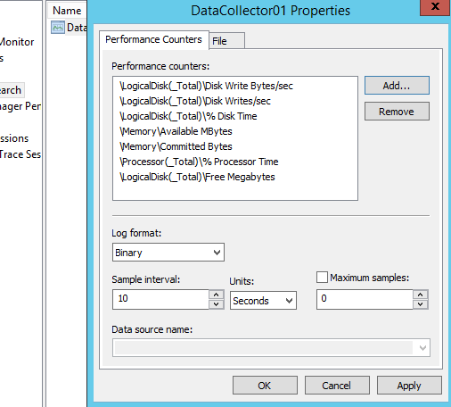
   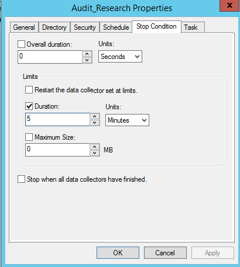

4. Конвертация:
   ```cmd
   relog C:\AuditResearch\Baseline\DataCollector.blg -f CSV -o C:\AuditResearch\Baseline\AuditResearch_Baseline.csv -y
   ```

   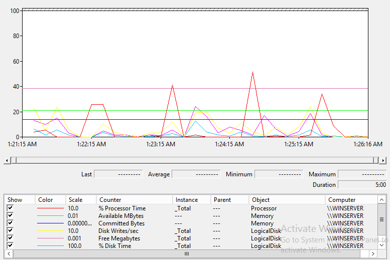
   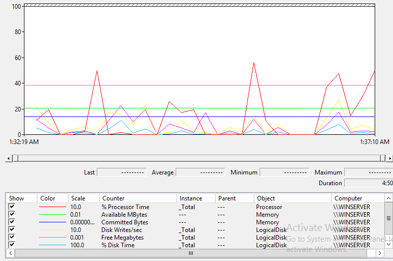
   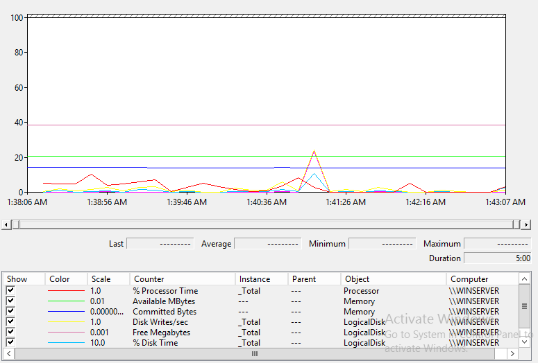
   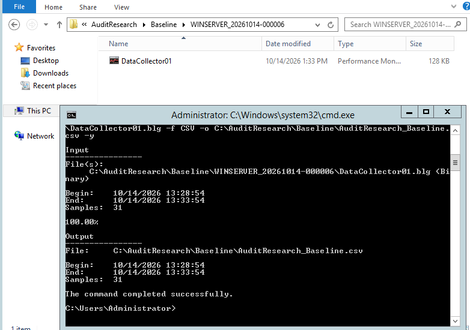

### Повторяемость

Для повышения статистической значимости выполняется 3 прогона. Результат — среднее по трём. Если разброс между прогонами превышает 20 %, увеличить число прогонов или уточнить метод.

## Результаты

| Показатель | тест 1 | тест 2 | тест 3 | Δ |
|---|---:|---:|---:|---:|
| Средняя загрузка CPU, % | 0.78 | 1.65 | 2.97 | 1.80 |
| Максимальная загрузка CPU, % | 5.14 | 5.63 | 10.17 | 6.98 |
| Средняя занятая память, Мбайт | 1319.50 | 1339.38 | 1347.10 | 1335.33 |
| Доступная память, Мбайт | 2087.33 | 2066.07 | 2062.73 | 2072.04 |
| Средний % Disk Time | 0.0178 | 0.0214 | 0.0635 | 0.0342 |
| Средний Disk Writes/sec | 0.6395 | 0.7481 | 1.4789 | 0.9555 |
| Средний Disk Write Bytes/sec | 5157.88 | 5870.74 | 10009.09 | 7012.57 |
| Средний Free Megabytes | 38677 | 38676 | 38676 | 38676.33 |
| Длительность, с | 300 | 300 | 300 | 300 |

---

## Расчёт \(U_{\text{исх}}\)

$$
U_{\text{исх}} = \frac{0.84 + 1.18 + 1.17}{3} \approx 1.06\ \%
$$

Так как \(U_{\text{исх}} < 5\%\), значение \(\Delta U\) на последующих этапах считается в пределах шума и используется только как справочное.

$$
U_{\text{нач}} = 0.3960\ \%
$$

$$
U_{\text{кон}} = 3.0400\ \%
$$

$$
\Delta U_{\text{фон}} = U_{\text{кон}} - U_{\text{нач}} = 3.0400 - 0.3960 = 2.6440\ \text{п.п.}
$$

$$
S_{\text{нач}} = 38677 \cdot 1048576 = 40\,560\,228\,352\ \text{байт}
$$

$$
S_{\text{кон}} = 38676 \cdot 1048576 = 40\,559\,179\,776\ \text{байт}
$$

$$
\Delta S_{\text{фон}} = S_{\text{нач}} - S_{\text{кон}} = 40\,560\,228\,352 - 40\,559\,179\,776 = 1\,048\,576\ \text{байт}
$$

**Фоновые поправки:**

| Показатель | Значение |
|---|---:|
| ΔU_фон, п.п. | 2.6440 |
| ΔS_фон, байт | 1 048 576 |
| Продолжительность, T, с | 600 |


---

## 5.1.6. Измерение фоновой активности журналирования

Фоновая активность измеряется без тестовых действий. Клиент включён и подключён к домену

### Порядок измерения

1. Прогрев 2 минуты.
2. Замер до. Зафиксировать:
   - время старта (`background_start.txt`);
   - свободное место на диске;
   - фактические размеры журналов (`Get-WinEvent -ListLog`);
   - значения счётчиков CPU (`Get-Counter`).
3. Ожидание 600 с без тестовых действий.
4. Замер после. Повторить все замеры.
5. Расчёт:
   - $N_i$ — число событий по каналу;
   - $V_i$ — прирост размера журнала;
   - $\lambda_i = N_i / T_i$;
   - $R_i = V_i / T_i$;
   - $\bar{s}_i = V_i / N_i$;

   ```powershell
   ./5_1_6.ps1
   ```

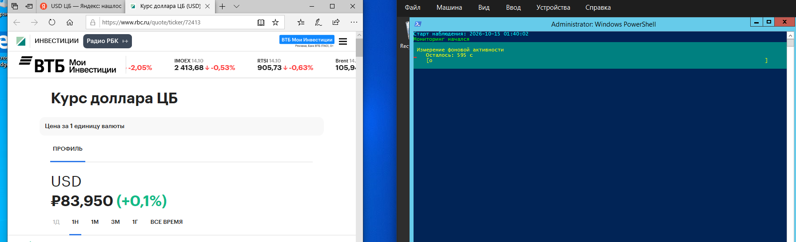

### Результаты

| Источник | T, с | N, шт. | V, байт | λ, событий/с | R, байт/с | s̄, байт/событие |
|---|---:|---:|---:|---:|---:|---:|
| Security | 603 | 0 | 0 | 0 | 0 | — |
| System | 603 | 0 | 0 | 0 | 0 | — |
| Application | 603 | 0 | 0 | 0 | 0 | — |
| Directory Service | 603 | 0 | 0 | 0 | 0 | — |
| GroupPolicy/Operational | 603 | 68 | 58 244 | 0.112769 | 96.59 | 856.53 |
| DNS Server | 603 | 0 | 0 | 0 | 0 | — |
| DNSServer/Audit | 603 | 9 | 7 988 | 0.014925 | 13.25 | 887.56 |
| Dhcp-Server/AuditLog | 603 | журналирование отсутствует | журналирование отсутствует | журналирование отсутствует | журналирование отсутствует | журналирование отсутствует |
| Dhcp-Server/Operational | 603 | 0 | 0 | 0 | 0 | — |
| RemoteAccess/Operational | 603 | 0 | 0 | 0 | 0 | — |
| RemoteAccess/Admin | 603 | 0 | 0 | 0 | 0 | — |
| RasRoutingProtocols/Operational | 603 | 0 | 0 | 0 | 0 | — |
| WFP/Operational | 603 | 0 | 0 | 0 | 0 | — |
| Firewall | 603 | 0 | 0 | 0 | 0 | — |
| NTLM/Operational | 603 | 0 | 0 | 0 | 0 | — |
| SMBServer/Operational | 603 | 0 | 0 | 0 | 0 | — |
| SMBServer/Security | 603 | 0 | 0 | 0 | 0 | — |
| SMBServer/Audit | 603 | 0 | 0 | 0 | 0 | — |
| SMBClient/Operational | 603 | 0 | 0 | 0 | 0 | — |
| SMBClient/Security | 603 | 0 | 0 | 0 | 0 | — |
| PowerShell/Operational | 603 | 4 | 3 194 | 0.006633 | 5.3 | 798.5 |
| TaskScheduler/Operational | 603 | 0 | 0 | 0 | 0 | — |


---

## 5.1.7. Тестовые действия, привязанные к модели угроз

Угрозы не воспроизводятся напрямую. Выполняются **безопасные легитимные действия**, формирующие **те же события в тех же журналах**, что и соответствующие угрозы. Опасные операции (очистка `Security`, изменение реальных GPO, удаление боевых DNS-зон, отключение аудита, отключение Defender) **не выполняются**.


| № | Моделируемая угроза | Действие | Ожидаемые события | Журнал поиска |
|---:|---|---|---|---|
| 1 | Подбор паролей | Одна неуспешная попытка входа тестового пользователя | 4625, 4771, 4776 | Security, Kerberos, NTLM |
| 2 | Похищенные учётные данные | Успешный вход; `runas /user:...` | 4624, 4648, 4672 | Security |
| 3 | Изменение привилегированных групп | Добавить и удалить тестового пользователя в тестовой группе | 4728, 4729, 4732, 4733, 4756, 4757 | Security |
| 4 | Создание скрытой учётной записи | Создать `audit_test_user`, включить | 4720, 4722, 4738 | Security |
| 5 | Удаление учётной записи | Удалить `audit_test_user` | 4726 | Security |
| 6 | Изменение GPO | Изменить описание **тестовой** GPO | 5136, GroupPolicy/Operational | Security, GroupPolicy |
| 7 | Изменение DNS | Добавить и удалить тестовую A-запись | DNS Server, DNSServer/Audit, 5136 | DNS, Security |
| 8 | Подмена DHCP-параметров | `ipconfig /release` и `/renew` на клиенте | Dhcp-Server/AuditLog, Dhcp-Server/Operational | DHCP |
| 9 | Несанкционированная маршрутизация RRAS | Просмотр и изменение тестового статического маршрута | RemoteAccess/Operational, System | RRAS, System |
| 10 | Нежелательные соединения через NAT | `ping 8.8.8.8`, `curl` к внешнему узлу с клиента | WinNat/Oper, WFP/Operational, Firewall | NAT, WFP, Firewall |
| 11 | Разрешение ранее запрещённых соединений | Создать и удалить тестовое правило firewall | 4946, 4947, 4948, Firewall | Security, Firewall |
| 12 | Запуск процесса | `notepad.exe` на клиенте | 4688 | Security |
| 13 | Выполнение сценария PowerShell | `Get-Process` в PowerShell | PowerShell/Operational, 4688 | PowerShell, Security |
| 14 | Закрепление в системе | Создать и удалить тестовое задание планировщика | 4698, 4702, TaskScheduler | Security, TaskScheduler |
| 15 | Распространение через SMB | Обратиться к тестовой общей папке | 5140, 5145, SMBClient, SMBServer | Security, SMB |
| 16 | Уничтожение следов | Не выполнять очистку. Проверить наличие 1102 в исторических записях | 1102 | Security |
| 17 | Изменение политики аудита | Не изменять политику. Проверить 4719 в исторических записях | 4719 | Security |

### Выполнение

Создадим OU под тест аудит, в котором пользователя User_Audit - pswd jokerge321-

запускаем скрипт 5_1_7_monitor.ps1


1. **Подбор паролей**  
   На клиенте:
   ```cmd
   runas /user:DOMAIN\aboba cmd
   ```
   Ввести **неверный** пароль.

   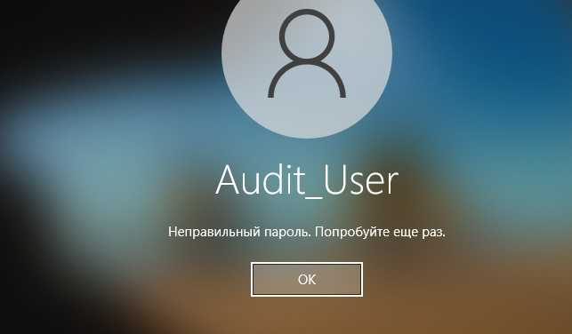

2. **Похищенные учётные данные**  
   На клиенте:
   ```cmd
   runas /user:toros.local\kupitman cmd
   ```
   Ввести **верный** пароль. В новом окне выполнить:
   ```cmd
   whoami
   ```

   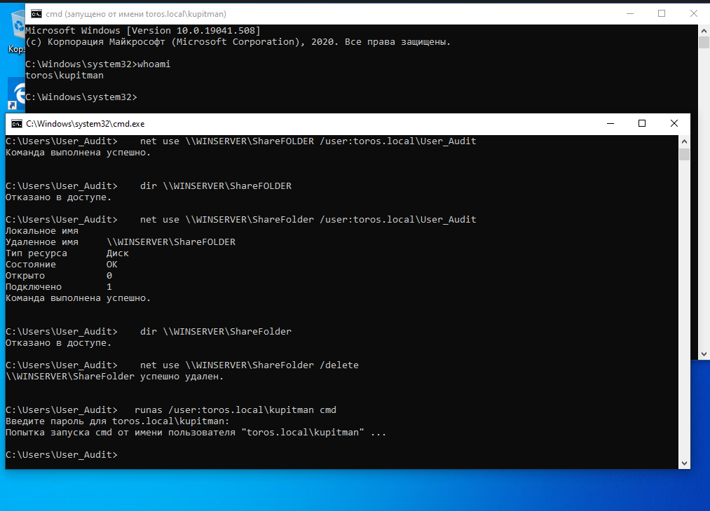

3. **Изменение привилегированных групп**  
   На контроллере домена:
   ```powershell
   Add-ADGroupMember -Identity "TestGroup" -Members "testuser"
   Remove-ADGroupMember -Identity "TestGroup" -Members "testuser" -Confirm:$false
   ```
   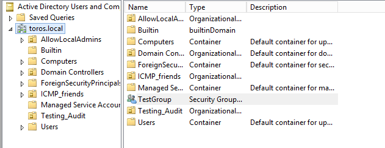
   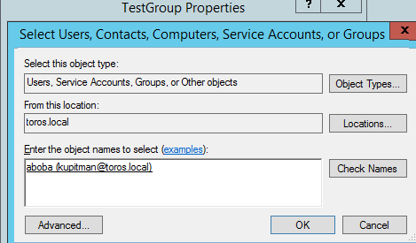


4. **Создание скрытой учётной записи**  
   На контроллере домена:
   ```powershell
   New-ADUser -Name "audit_test_user" -SamAccountName "audit_test_user" -Enabled $true -AccountPassword (ConvertTo-SecureString "P@ssw0rd" -AsPlainText -Force)
   Enable-ADAccount -Identity "audit_test_user"
   ```

   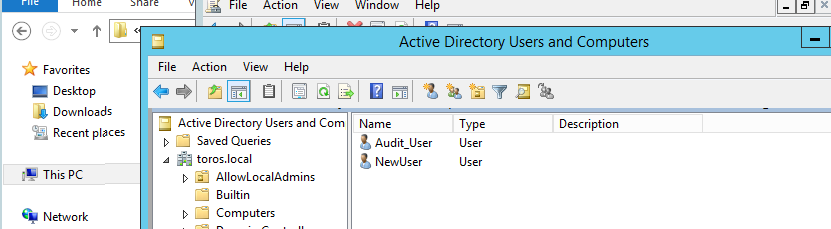

5. **Удаление учётной записи**  
   На контроллере домена:
   ```powershell
   Remove-ADUser -Identity "audit_test_user" -Confirm:$false
   ```

6. **Изменение GPO**  
   На контроллере домена:
   ```powershell
   Get-GPO -Name "TestGPO" | Set-GPO -Description "Audit test $(Get-Date)"
   ```

   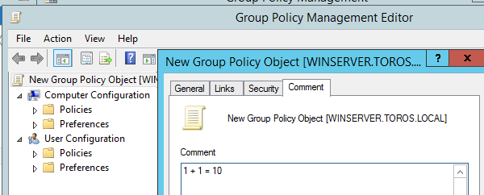

7. **Изменение DNS**  
   На DNS-сервере:
   ```powershell
   Add-DnsServerResourceRecordA -Name "audit-test" -ZoneName "example.com" -IPv4Address "192.168.1.99"
   Remove-DnsServerResourceRecord -Name "audit-test" -ZoneName "example.com" -RRType A -Confirm:$false
   ```
   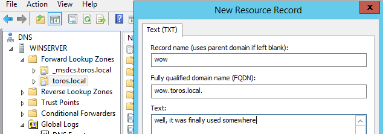

8. **Подмена DHCP-параметров**  
   На клиенте:
   ```cmd
   ipconfig /release
   ipconfig /renew
   ```
   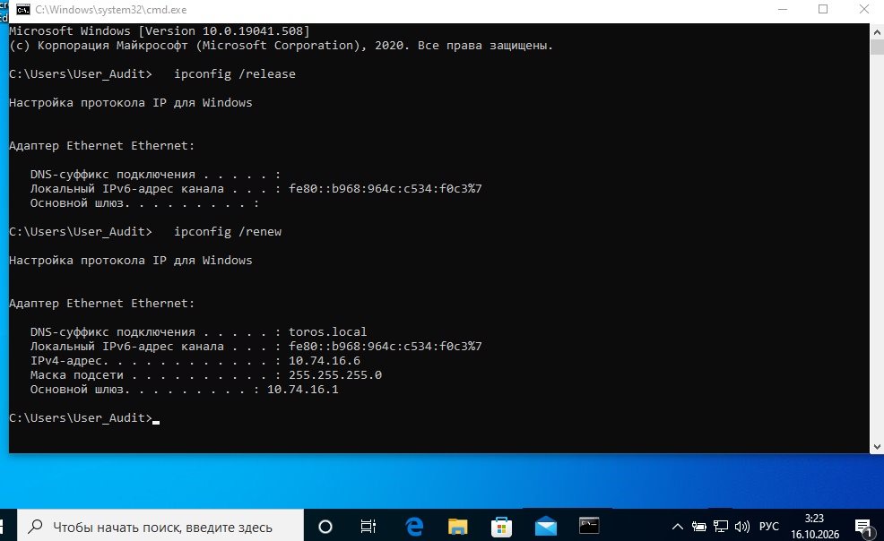

9. **Несанкционированная маршрутизация RRAS**  
   На RRAS-сервере:
   ```powershell
   Get-NetRoute
   New-NetRoute -DestinationPrefix "10.99.99.0/24" -InterfaceIndex (Get-NetAdapter | Where-Object Status -eq "Up").ifIndex -NextHop "192.168.1.1"
   Remove-NetRoute -DestinationPrefix "10.99.99.0/24" -Confirm:$false
   ```
   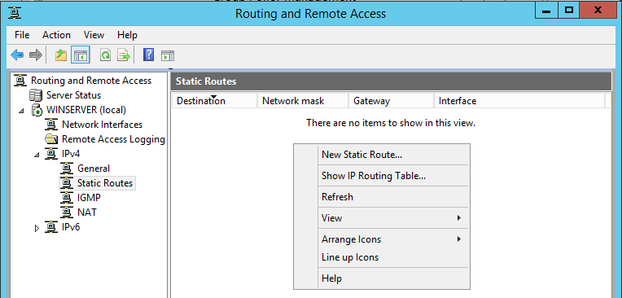
   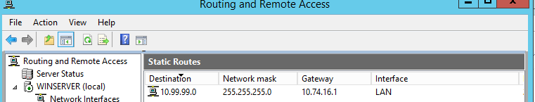

10. **Нежелательные соединения через NAT**  
    На клиенте:
    ```cmd
    ping 8.8.8.8
    curl http://example.com
    ```

   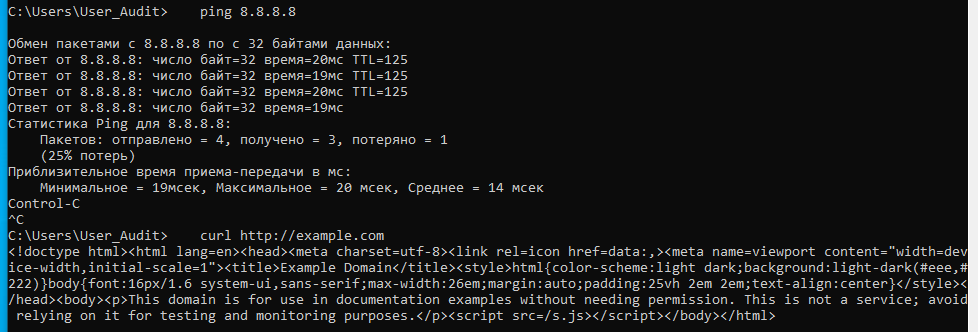

11. **Разрешение ранее запрещённых соединений**  
    На сервере или клиенте:
    ```powershell
    New-NetFirewallRule -DisplayName "Audit Test Rule" -Direction Outbound -Action Allow -Protocol TCP -RemotePort 12345
    Remove-NetFirewallRule -DisplayName "Audit Test Rule"
    ```

   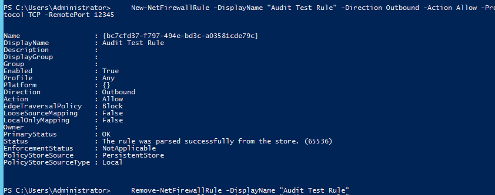
   

12. **Запуск процесса**  
    На клиенте:
    ```cmd
    notepad.exe
    ```

   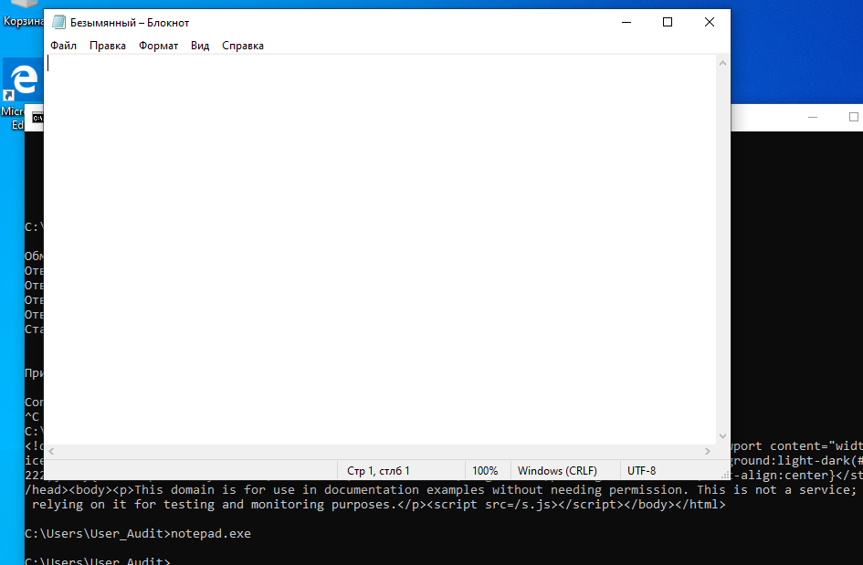

13. **Выполнение сценария PowerShell**  
    На клиенте:
    ```powershell
    Get-Process
    ```

    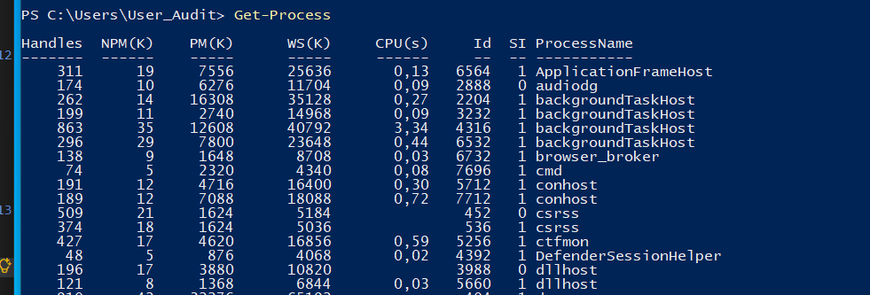

14. **Закрепление в системе**  
    На клиенте или сервере:
    ```powershell
    $action  = New-ScheduledTaskAction -Execute "notepad.exe"
    $trigger = New-ScheduledTaskTrigger -Once -At (Get-Date).AddMinutes(1)
    Register-ScheduledTask -TaskName "AuditTestTask" -Action $action -Trigger $trigger -User "SYSTEM"
    Unregister-ScheduledTask -TaskName "AuditTestTask" -Confirm:$false
    ```

    в ShareFolder

15. **Распространение через SMB**  
    На клиенте:
    ```cmd
    net use \\WINSERVER\ShareFolder /user:toros.local\User_Audit
    dir \\WINSERVER\ShareFolder
    net use \\WINSERVER\ShareFolder /delete
    ```

   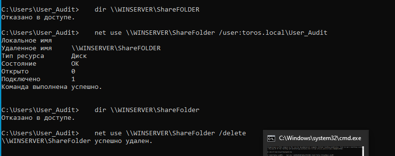 

16. **Уничтожение следов**  
    Ничего не выполнять. Проверить в Event Viewer → Security наличие события **1102** за прошлые периоды.

17. **Изменение политики аудита**  
    Ничего не изменять. Проверить в Event Viewer → Security наличие события **4719** за прошлые периоды.


### Результаты

По данным `background_eventids_*.csv` за интервал мониторинга.

| № | Действие | Выполнено | Время | Найдено событие | ID | Источник | Совпадает с моделью | Комментарий |
|---:|---|---|---|---|---|---|---|---|
| 1 | Неуспешный вход | Да | — | Нет | — | — | **Нет** | 4625/4771/4776 не зафиксированы: `Logon`, `Kerberos Authentication Service`, `Credential Validation` = No Auditing |
| 2 | Успешный вход + runas | Да | — | Нет | — | — | **Нет** | 4624/4648/4672 не зафиксированы: `Logon`, `Special Logon` = No Auditing |
| 3 | Изменение состава тестовой группы | Да | — | Частично | 4727, 4730 | Security | **Нет** | Зафиксированы создание/удаление группы (4727/4730), а не изменение состава. Ожидались 4728/4729/4732/4733/4756/4757 |
| 4 | Создание тестового пользователя | Да | — | Нет | — | — | **Нет** | 4720/4722/4738 не зафиксированы: `User Account Management` = No Auditing |
| 5 | Удаление тестового пользователя | Да | — | Нет | — | — | **Нет** | 4726 не зафиксировано: `User Account Management` = No Auditing |
| 6 | Изменение описания тестовой GPO | Да | — | Частично | 5320, 5017, 4017, 5310, 5311, 4016, 5313 и др. | GroupPolicy/Operational | **Частично** | 5136 не зафиксировано (`Directory Service Changes` = No Auditing). События GroupPolicy относятся к фоновой обработке GPO, а не к изменению описания |
| 7 | Добавление и удаление тестовой A-записи | Да | — | Да | 519, 520, 515 | DNSServer/Audit | **Да** | 519 — создание записи, 520 — удаление, 515 — операция с зоной. 5136 не зафиксировано, но DNS-события есть |
| 8 | DHCP renew | Да | — | Нет | — | — | **Нет** | `Dhcp-Server/AuditLog` отключён, `Dhcp-Server/Operational` — 0 событий |
| 9 | Изменение тестового маршрута RRAS | Да | — | Частично | 7036 (×2), 5186 | System | **Частично** | `RemoteAccess/Operational` — 0 событий. 7036 — смена состояния службы, 5186 — сетевое событие. Прямых событий изменения маршрута нет |
| 10 | Обращение к внешнему узлу через NAT | Да | — | Нет | — | — | **Нет** | `WinNat/Operational`, `WFP/Operational` — 0 событий. Firewall 2004/2006 относятся к правилам, а не к NAT |
| 11 | Создание и удаление тестового правила firewall | Да | — | Да | 2004, 2006 | Firewall | **Да** | 2004 — правило добавлено, 2006 — правило удалено. 4946–4948 не зафиксированы (`MPSSVC Rule-Level Policy Change` = No Auditing) |
| 12 | notepad | Да | — | Нет | — | — | **Нет** | 4688 не зафиксировано: `Process Creation` = No Auditing |
| 13 | PowerShell Get-Process | Да | — | Да | 4104 (×116), 40961 (×3), 40962 (×3), 53504 (×3) | PowerShell/Operational | **Да** | 4104 — блок сценария, 40961/40962 — старт/остановка, 53504 — создание провайдера. 4688 не зафиксировано |
| 14 | Создание и удаление тестового задания | Да | — | Да | 106 (×1), 140 (×4), 141 (×1) | TaskScheduler/Operational | **Да** | 106 — задание зарегистрировано, 140 — обновлено, 141 — удалено. 4698/4702 не зафиксированы (`Other Object Access Events` = No Auditing) |
| 15 | Обращение к тестовой SMB-папке | Да | — | Нет | — | — | **Нет** | 5140/5145 не зафиксированы (`Object Access → File Share` = No Auditing). `SMBClient/Operational`, `SMBServer/Operational` — 0 событий |

## 5.1.8. Сбор событий после тестовой нагрузки

Объединённая таблица результатов: сопоставление тестового действия, ожидаемых событий, фактического покрытия и решения для конфигураций B и C.

| № | Моделируемая угроза | Действие | Ожидаемый ID | Покрытие | Причина | Решение |
|---:|---|---|---|---|---|---|
| 1 | Подбор паролей | Неуспешный вход | 4625, 4771, 4776 | 0 | `Logon`, `Kerberos Authentication Service`, `Credential Validation` = No Auditing. События не сформированы | Включить `Audit Logon` (Success and Failure); `Audit Kerberos Authentication Service`; `Audit Credential Validation` |
| 2 | Похищенные учётные данные | Успешный вход + `runas` | 4624, 4648, 4672 | 0 | `Logon`, `Special Logon` = No Auditing. События не сформированы | Включить `Audit Logon`; `Audit Special Logon` |
| 3 | Изменение групп | Изменение состава тестовой группы | 4728, 4729, 4732, 4733, 4756, 4757 | 0 (ложное) | `Security Group Management` включён, но сформированы 4727/4730 — создание/удаление группы, а не изменение состава. Ожидаемый ID не найден — FP | Проверить, что тест меняет состав группы, а не создаёт/удаляет её; `Security Group Management` уже включён |
| 4 | Скрытая учётная запись | Создание тестового пользователя | 4720, 4722, 4738 | 0 | `User Account Management` = No Auditing. События не сформированы | Включить `Audit User Account Management` |
| 5 | Удаление учётной записи | Удаление тестового пользователя | 4726 | 0 | `User Account Management` = No Auditing. Событие не сформировано | Включить `Audit User Account Management` |
| 6 | GPO | Изменение описания тестовой GPO | 5136, GroupPolicy/Operational | 0,5 | `Microsoft-Windows-GroupPolicy/Operational` включён (5320×42, 5017×28, 4017×28 и др.), но 5136 отсутствует: `Directory Service Changes` = No Auditing. События GroupPolicy — фоновые, не от изменения описания | Включить `Audit Directory Service Changes` |
| 7 | DNS | Добавление и удаление тестовой A-записи | DNS Server, DNSServer/Audit, 5136 | 1,0 | `Microsoft-Windows-DNSServer/Audit` включён: 519×14, 520×8, 515×1. 5136 отсутствует, но ключевые DNS-события зафиксированы | Достаточно; при необходимости включить `Audit Directory Service Changes` для 5136 |
| 8 | DHCP | `DHCP renew` | Dhcp-Server/AuditLog | Не проверено | Канал `Microsoft-Windows-Dhcp-Server/AuditLog` отключён (`enabled: false`). `Dhcp-Server/Operational` — 0 событий | Включить канал `Microsoft-Windows-Dhcp-Server/AuditLog` и аудит DHCP-сервера |
| 9 | RRAS | Изменение тестового маршрута RRAS | RemoteAccess/Operational, System | 0,5 | `System`: 7036×2, 5186×1 (косвенно). `RemoteAccess/Operational` — 0 событий. Прямых признаков изменения маршрута нет | Проверить, что `Microsoft-Windows-RemoteAccess-RemoteAccessServer/Operational` включён и настроен на регистрацию маршрутов |
| 10 | NAT | Обращение к внешнему узлу через NAT | WinNat/Oper, WFP/Operational, Firewall | 0,5 | `Firewall`: 2004×1, 2006×1 (относятся к правилам, а не NAT). `WinNat/Operational`, `WFP/Operational` — 0 событий | Включить `Microsoft-Windows-WinNat/Operational` и `Microsoft-Windows-WFP/Operational`, настроить регистрацию соединений |
| 11 | Firewall | Создание и удаление тестового правила firewall | 4946, 4947, 4948, Firewall | 0,5 | `Firewall`: 2004×1, 2006×1 (правило создано/удалено). 4946/4947/4948 не сформированы: `MPSSVC Rule-Level Policy Change` = No Auditing | Включить `Audit MPSSVC Rule-Level Policy Change` (Success and Failure) |
| 12 | Запуск процесса | `notepad.exe` | 4688 | 0 | `Process Creation` = No Auditing. Событие не сформировано | Включить `Audit Process Creation` (Success) |
| 13 | PowerShell | `Get-Process` в PowerShell | PowerShell/Operational, 4688 | 0,5 | `PowerShell/Operational`: 4104×116, 40961×3, 40962×3, 53504×3. 4688 не сформировано: `Process Creation` = No Auditing | Включить `Audit Process Creation` |
| 14 | Закрепление | Создание и удаление тестового задания | 4698, 4702, TaskScheduler | 0,5 | `TaskScheduler/Operational`: 106×1, 140×4, 141×1. 4698/4702 не сформированы: `Other Object Access Events` = No Auditing | Включить `Audit Other Object Access Events` (Success and Failure) |
| 15 | SMB | Обращение к тестовой SMB-папке | 5140, 5145, SMBClient, SMBServer | 0 | 5140/5145 не сформированы: `Object Access → File Share`, `Detailed File Share` = No Auditing. `SMBClient/Operational`, `SMBServer/Operational` — 0 событий | Включить `Audit Object Access → File Share`, `Detailed File Share` (Success and Failure) |
| 16 | Очистка журналов | Проверка исторических записей | 1102 | Не проверено | Проверка исторических записей. Тестовое действие не выполнялось. 1102 в журнале Security за проверяемый период отсутствует | Историческая проверка, изменений не требуется |
| 17 | Изменение политики аудита | Проверка исторических записей | 4719 | Не проверено | Проверка исторических записей. Тестовое действие не выполнялось. 4719 не сформировано: `Audit Policy Change` = No Auditing | Включить `Audit Policy Change` для будущих проверок |

## Каналы и подкатегории для включения

| Канал / подкатегория | Текущее состояние | Действие |
|---|---|---|
| `Audit Logon` | No Auditing | Success and Failure |
| `Audit Special Logon` | No Auditing | Success |
| `Audit Credential Validation` | No Auditing | Success and Failure |
| `Audit Kerberos Authentication Service` | No Auditing | Success and Failure |
| `Audit User Account Management` | No Auditing | Success and Failure |
| `Audit Process Creation` | No Auditing | Success |
| `Audit Directory Service Changes` | No Auditing | Success |
| `Audit MPSSVC Rule-Level Policy Change` | No Auditing | Success and Failure |
| `Audit Other Object Access Events` | No Auditing | Success and Failure |
| `Audit Object Access → File Share` | No Auditing | Success and Failure |
| `Audit Object Access → Detailed File Share` | No Auditing | Success and Failure |
| `Audit Policy Change` | No Auditing | Success and Failure |
| `Microsoft-Windows-Dhcp-Server/AuditLog` | Отключён (`enabled: false`) | Включить |
| `Microsoft-Windows-WinNat/Operational` | 0 событий | Проверить роль NAT и включить канал |
| `Microsoft-Windows-WFP/Operational` | 0 событий | Включить и настроить регистрацию |
| `Microsoft-Windows-RemoteAccess-RemoteAccessServer/Operational` | 0 событий | Проверить настройки аудита RRAS |
| `Microsoft-Windows-SMBServer/Operational` | 0 событий | Проверить настройки аудита SMB-сервера |
| `Microsoft-Windows-SMBClient/Operational` | 0 событий | Проверить настройки аудита SMB-клиента |

## 5.1.9. Проверка полноты регистрации

### Расчёт

### 1. Взвешенная сумма

$$
\sum w_i = 1 \times 1 + 6 \times 0{,}5 + 7 \times 0 = 1 + 3 + 0 = 4
$$

$$
C = \frac{4}{14} \times 100\% = 28{,}6\%
$$

### 2. Классификация результатов

| Показатель | Значение | Пояснение |
|---|---|---|
| **TP** (True Positive) | 1 | №7 — DNS |
| **FP** (False Positive) | 1 | №3 — найдены 4727/4730 вместо 4728/4729/4732/4733/4756/4757 |
| **FN** (False Negative) | 6 | №1, №2, №4, №5, №12, №15 |

### 3. Метрики качества

$$
\text{Precision} = \frac{TP}{TP + FP} = \frac{1}{1 + 1} = 0{,}50
$$

$$
\text{Recall} = \frac{TP}{TP + FN} = \frac{1}{1 + 6} = 0{,}143
$$

Сценарии с частичным обнаружением (w = 0,5) — №6, 9, 10, 11, 13, 14 — в TP/FP/FN не входят.

## Результаты

| Показатель | Значение |
|---|---:|
| Всего сценариев | 17 |
| Выполнено | 14 |
| Обнаружено (w = 1) | 1 |
| Частично обнаружено (w = 0,5) | 6 |
| Не обнаружено (w = 0) | 7 |
| Невозможно проверить | 3 |
| Покрытие C, % | **28,6** |
| TP | 1 |
| FP | 1 |
| FN | 6 |
| Precision (условно) | **0,50** |
| Recall (условно) | **0,14** |

## 5.1.10. Расчёт объёма журналирования

## Исходные данные

Интервал измерения: **T = 2095 с**.

Суммарная скорость поступления данных по всем журналам:

$$
R_{\Sigma} = \sum_i R_i
$$

| Журнал | R, байт/с |
|---|---:|
| Security | 0.98 |
| System | 1.10 |
| GroupPolicy/Operational | 97.29 |
| DNSServer/Audit | 9.79 |
| Firewall | 1.27 |
| PowerShell/Operational | 2002.05 |
| TaskScheduler/Operational | 2.24 |
| **Итого** | **2114.72** |

Журналы с `R = 0` и `Dhcp-Server/AuditLog` (журналирование отсутствует) в сумму не входят.

---

## Расчёт суточного объёма

$$
V_{сут} = R_{\Sigma} \cdot 86400
$$

$$
V_{сут} = 2114{,}72 \cdot 86400 = 182\,711\,808 \text{ байт}
$$

**V_сут ≈ 182,7 МБ/сутки** (или ≈ 174,3 МиБ/сутки).

---

## Расчёт объёма с резервом

При `K = 1,3`, `D = 30` суток:

$$
V_{резерв} = K \cdot D \cdot V_{сут}
$$

$$
V_{резерв} = 1{,}3 \cdot 30 \cdot 182\,711\,808 = 7\,125\,760\,512 \text{ байт}
$$

**V_резерв ≈ 7,13 ГБ** (или ≈ 6,64 ГиБ).

---

## Итоговая таблица

| Показатель | Значение |
|---|---:|
| T, с | 2095 |
| R_Σ, байт/с | 2114,72 |
| V_сут, байт | 182 711 808 |
| V_сут, МБ | ≈ 182,7 |
| D, суток | 30 |
| K | 1,3 |
| V_резерв, байт | 7 125 760 512 |
| V_резерв, ГБ | ≈ 7,13 |

---

## Примечания

1. **Основной вклад** в суточный объём даёт `PowerShell/Operational` — 2002,05 байт/с (≈ 94,7 % от R_Σ). Это связано с событием **4104** (блок сценария), которое записывается при каждом выполнении PowerShell. Без него R_Σ был бы всего ≈ 112,67 байт/с, а V_сут ≈ 9,73 МБ/сутки.
2. **GroupPolicy/Operational** даёт 97,29 байт/с (≈ 4,6 %), **DNSServer/Audit** — 9,79 байт/с (≈ 0,5 %), остальные — менее 0,1 %.
3. Расчёт выполнен для интервала с тестовыми действиями. Для фонового режима (без тестов) значения будут существенно ниже — см. п. 5.1.6.
4. Если журнал `PowerShell/Operational` настроен на регистрацию **4104** только для подозрительных сценариев, суточный объём снизится пропорционально.
5. Формула `V_резерв = K · D · V_сут` даёт объём **без сжатия**. При включённом сжатии `.evtx` фактический объём на диске может быть меньше в 2–4 раза.

