# 5.1. Практическое исследование исходной конфигурации аудита и журналирования Windows Server 2012

## 5.1.1. Содержание этапа

- Фиксация исходного состояния контроллера домена и сетевых служб.
- Сохранение исходной политики аудита.
- Инвентаризация журналов событий и параметров их хранения.
- Измерение исходной загрузки процессора и потребления оперативной памяти.
- Измерение фоновой активности журналирования.
- Выполнение контрольных действий в доменной сети.
- Сбор и анализ событий Active Directory, DNS, DHCP и RRAS.
- Проверка полноты регистрации тестовых действий.
- Расчёт объёма журналирования и оформление результатов.

## 5.1.2. Фиксация исходного состояния контроллера домена

На первом этапе необходимо зафиксировать конфигурацию Windows Server 2012 до внесения изменений в политику аудита. Сервер рассматривается как единый исследуемый узел, выполняющий функции контроллера домена, DNS-сервера, DHCP-сервера и маршрутизатора с использованием NAT и RRAS.

### 5.1.2.1. Порядок выполнения

3. Создать каталог для сохранения результатов эксперимента:

   ```cmd
   mkdir C:\AuditResearch
   mkdir C:\AuditResearch\Baseline
   mkdir C:\AuditResearch\Baseline\Logs
   mkdir C:\AuditResearch\Baseline\Exports
   ```
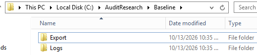

5. Сохранить сведения об операционной системе, оборудовании виртуальной машины и имени сервера:

   ```cmd
   systeminfo > C:\AuditResearch\Baseline\systeminfo.txt
   hostname >> C:\AuditResearch\Baseline\systeminfo.txt
   ```
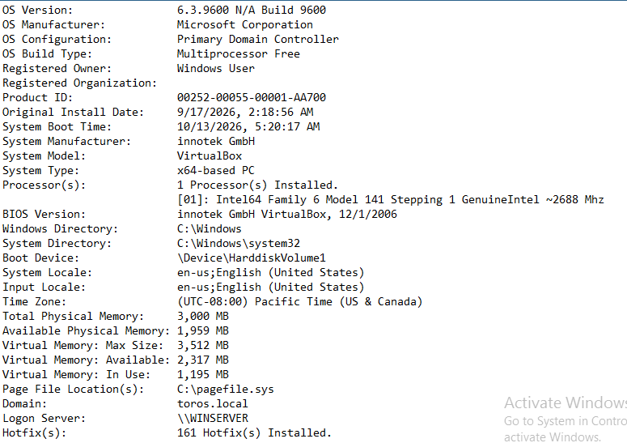

6. Сохранить параметры сетевых интерфейсов:

   ```cmd
   ipconfig /all > C:\AuditResearch\Baseline\ipconfig.txt
   ```

7. Зафиксировать таблицу маршрутизации:

   ```cmd
   route print > C:\AuditResearch\Baseline\routes.txt
   ```
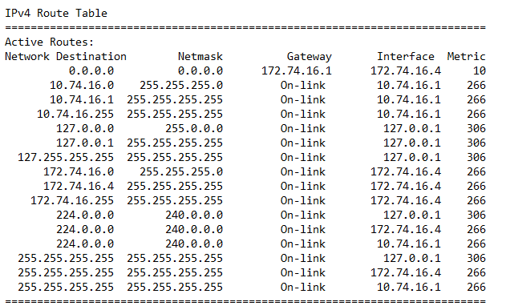

8. Сохранить сведения о состоянии основных служб:

   ```cmd
   sc query NTDS > C:\AuditResearch\Baseline\services.txt
   sc query DNS >> C:\AuditResearch\Baseline\services.txt
   sc query DHCPServer >> C:\AuditResearch\Baseline\services.txt
   sc query RemoteAccess >> C:\AuditResearch\Baseline\services.txt
   ```

   Служба `NTDS` соответствует службе каталогов Active Directory, `DNS` — службе DNS, `DHCPServer` — службе DHCP, `RemoteAccess` — службе удалённого доступа и маршрутизации RRAS.

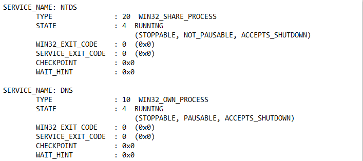

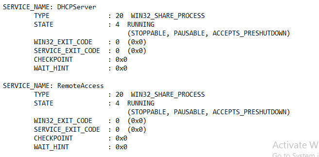

12. Узнать размер и объём свободного пространства системного диска:

    ```cmd
    wmic logicaldisk where "DeviceID='C:'" get DeviceID,Size,FreeSpace
    ```

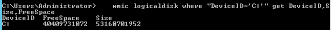

### 5.1.2.2. Результаты измерения

| | |
|---|---|
| **Имя сервера** | WINSERVER |
| **Домен Active Directory** | toros.local |
| **Версия операционной системы** | Windows Server 2012 R2 Standard (6.3.9600 Build 9600) |
| **IP-адрес внутреннего интерфейса** | 10.74.16.1 (LAN) |
| **IP-адрес внешнего интерфейса** | 172.74.16.4 (WAN) |
| **Состояние Active Directory** | RUNNING (NTDS) |
| **Состояние DNS** | RUNNING |
| **Состояние DHCP** | RUNNING |
| **Состояние RRAS** | RUNNING (RemoteAccess) |
| **Состояние NAT** | RUNNING (в составе службы RemoteAccess) |
| **Объём оперативной памяти, Мбайт** | 3000 |
| **Размер системного диска, байт** | 53160701952 |
| **Свободное место на диске, байт** | 40409731072 |


## 5.1.3. Сохранение исходной политики аудита

На данном этапе необходимо получить действующие настройки аудита Windows Server 2012. Они определяют, какие действия пользователей, администраторов и системных компонентов могут регистрироваться в журнале безопасности.

### 5.1.3.1. Порядок выполнения


3. Сохранить результат аудита:

   ```cmd
   auditpol /get /category:* > C:\AuditResearch\Baseline\audit_policy.txt
   ```
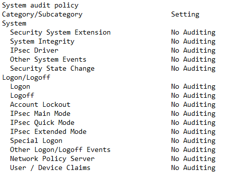
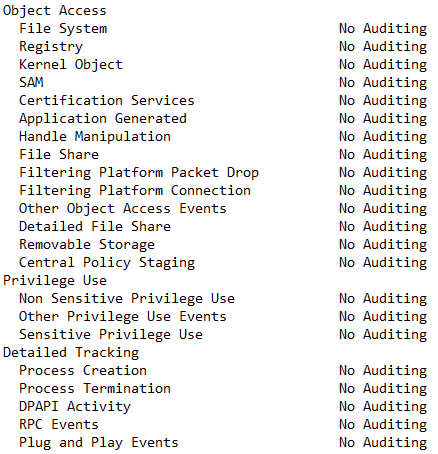
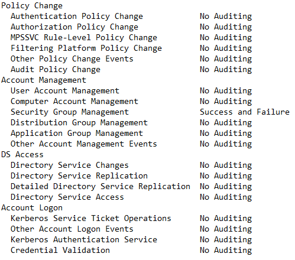

4. Дополнительно сохранить конфигурацию аудита безопасности в файл резервной копии:

   ```cmd
   auditpol /backup /file:C:\AuditResearch\Baseline\audit_policy_backup.csv
   ```

7. Сохранить результирующую политику групповых политик:

   ```cmd
   gpresult /h C:\AuditResearch\Baseline\gpresult.html
   ```

8. Сохранить список зарегистрированных каналов событий:

   ```cmd
   wevtutil el > C:\AuditResearch\Baseline\event_channels.txt
   ```

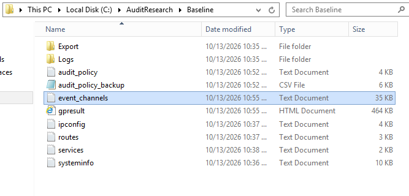

### 5.1.3.2. Результаты измерения

| | |
|---|---|
| **Политика аудита сохранена** | Да (файл `System audit policy.txt`) |
| **Резервная копия политики создана** | Да (файл `System audit policy.txt` содержит исходное состояние) |
| **Результирующая политика сохранена** | Да (файл `Group Policy Management.txt` — отчёт Group Policy Results) |
| **Расширенная политика аудита настроена через доменную GPO** | Да (в `Default Domain Controllers Policy` настроена подкатегория `Audit Security Group Management` = Success, Failure) |
| **Журнал Security содержит события** | Да (в списке журналов присутствуют `Security`, `Microsoft-Windows-DHCP-Server/AuditLog` и другие каналы безопасности) |
| **Исходная конфигурация изменена** | Нет |

## 5.1.4. Инвентаризация журналов событий

На данном этапе необходимо определить, какие журналы используются для регистрации событий безопасности, работы DNS, DHCP и RRAS, а также какие ограничения хранения для них установлены.

### 5.1.4.1. Порядок выполнения

6. Проверить размеры файлов журналов событий:

   ```cmd
   dir C:\Windows\System32\winevt\Logs\*.evtx > C:\AuditResearch\Baseline\evtx_sizes.txt
   ```

11. Сохранить список активных каналов событий:
   
   ```powershell
   Get-WinEvent -ListLog * | Where-Object IsEnabled |
      Select-Object LogName, RecordCount, FileSize, MaximumSizeInBytes |
      Export-Csv C:\AuditResearch\Baseline\enabled_channels.csv -NoTypeInformation -Encoding UTF8
   ```

### 5.1.4.2. Результаты измерения


| Источник | Подкатегория (канал) | Журналирование включено | Максимальный размер, байт | Фактический размер, байт |
|---|---|---|---|---|
| **Security** | Security | Да | 134 217 728 | 6 361 088 |
| **System** | System | Да | 20 971 520 | 2 166 784 |
| **Application** | Application | Да | 20 971 520 | 1 118 208 |
| **DNS Server** | Microsoft-Windows-DNSServer/Audit | Да | 104 857 600 | 1 118 208 |
| **DHCP Server** | DhcpAdminEvents | Да | 1 052 672 | 69 632 |
|  | Microsoft-Windows-Dhcp-Server/Operational | Да | 1 052 672 | 69 632 |
|  | Microsoft-Windows-Dhcp-Server/FilterNotifications | Да | 1 052 672 | 69 632 |
| **RRAS** | Microsoft-Windows-RemoteAccess-RemoteAccessServer/Admin | Да | 1 052 672 | 69 632 |
|  | Microsoft-Windows-RemoteAccess-RemoteAccessServer/Operational | Да | 1 052 672 | 69 632 |


## 5.1.5. Измерение исходной нагрузки на процессор и оперативную память

На данном этапе определяется фоновое потребление системных ресурсов при работающих службах Active Directory, DNS, DHCP и RRAS.

# 5.1.5. Оценка базовой загрузки процессора и памяти

   Запустить perfmon.msc (Win+R → perfmon.msc).

   Data Collector Sets → User Defined → New → Data Collector Set.

   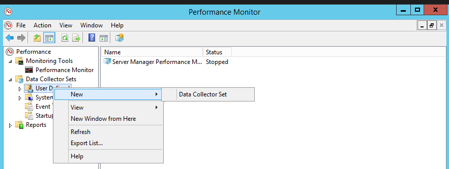   

   Имя: AuditResearch_Baseline, тип — Create manually (Advanced) → Next.

   Create data logs → Performance counter data collector → Next.

   Add счётчики:

      Processor(_Total)\% Processor Time

      Memory\Committed Bytes

      Memory\Available MBytes

      LogicalDisk(_Total)\Disk Writes/sec

      LogicalDisk(_Total)\Disk Write Bytes/sec

      LogicalDisk(_Total)\% Disk Time

   Sample interval = 10 с, Root directory = C:\AuditResearch\Baseline → Next → Finish.

   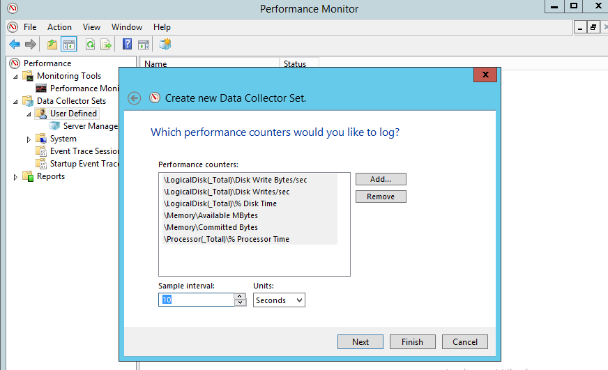

   Duration - 300 с

   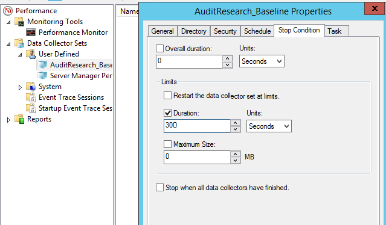

   Конвертировать .blg в CSV:
   cmd

   relog C:\AuditResearch\Baseline\AuditResearch_Baseline.blg -f CSV -o C:\AuditResearch\Baseline\AuditResearch_Baseline.csv -y

   Рассчитать средние и максимальные значения по столбцам CSV.

   Сам клиент при этом сидит в браузере

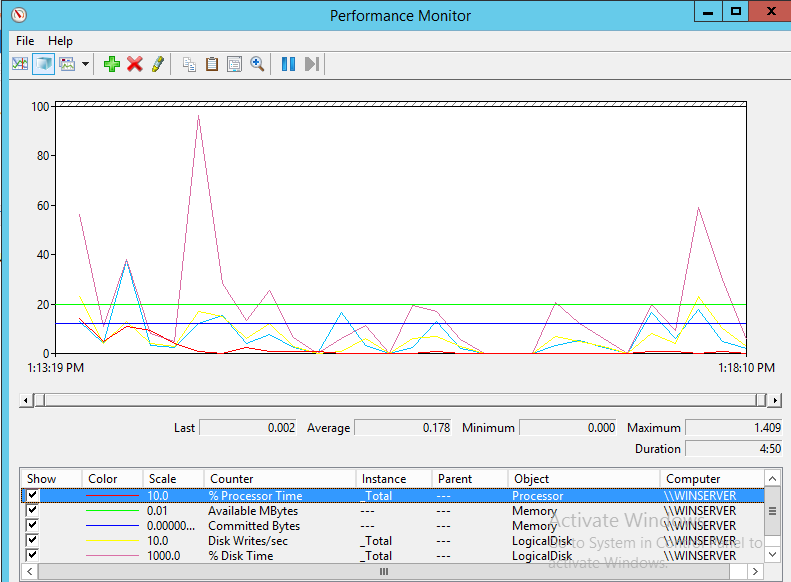

### Результаты измерения

| Показатель | Исходное значение |
|---|---:|
| Средняя загрузка процессора, % | 0,178 |
| Максимальная загрузка процессора, % | 1,409 |
| Среднее значение занятой памяти, Мбайт | 1 004,81 |
| Доступная память, Мбайт | 1 997,60 |
| Средняя занятость диска (`% Disk Time`) | 0,018 |
| Средняя скорость записи на диск (`Disk Writes/sec`) | 0,641 |
| Средний объём записи на диск (`Disk Write Bytes/sec`) | 6 834,193 |
| Продолжительность измерения, с | 300 |
| Интервал измерения, с | 10 |

## 5.1.6. Измерение фоновой активности журналирования

На данном этапе необходимо определить количество событий, возникающих при штатной работе всех служб сервера без целенаправленных тестовых действий.

### 5.1.6.1. Порядок выполнения

Убедиться, что клиентская машина подключена к домену и сети, но никаких действий в AD DS, DNS, DHCP и RRAS не выполняется.

Запустить PowerShell *5_1_6.ps1*  скрипт, который:
зафиксирует время начала и окончания наблюдения в C:\AuditResearch\Baseline\background_start.txt и background_end.txt;

подождёт 10 минут (600 секунд);

подсчитает количество событий по каждому каналу;

рассчитает интенсивность;

сохранит результаты в CSV и выведет итоговую таблицу.

### 5.1.6.2. Результаты измерения

| Источник | Продолжительность, с | Количество записей | Интенсивность, записей/с |
|---|---:|---:|---:|
| Security | 600 | | |
| System | 600 | | |
| Application | 600 | | |
| DNS Server | 600 | | |
| DHCP Server | 600 | | |
| RRAS | 600 | | |

Интенсивность регистрации рассчитывается по формуле:

$$
\lambda_i=\frac{N_i}{T_i}
$$

где $N_i$ — количество записей конкретного источника, $T_i$ — продолжительность наблюдения.

Если отдельный источник не ведёт журналирование, вместо нулевого количества событий следует указывать «журналирование отсутствует» или «данные недоступны». Ноль означает, что источник проверен и за установленный интервал не зарегистрировал ни одной записи.

## 5.1.7. Выполнение тестовых действий в доменной сети

На данном этапе необходимо выполнить одинаковый набор операций, охватывающий Active Directory, DNS, DHCP, доступ к сетевым ресурсам и маршрутизацию NAT. Эти действия выполняются в исходной конфигурации без изменения параметров аудита.

### 5.1.7.1. Порядок выполнения

1. На клиентской Windows 10 выполнить успешный вход в домен. Записать имя тестовой учётной записи и точное время входа.

2. Выполнить одну попытку входа с неправильным паролем тестовой учётной записи. 

3. На сервере открыть `Server Manager → Tools → Active Directory Users and Computers`. Найти тестового пользователя, открыть `Properties` и изменить поле `Description`. Записать время операции.

4. В той же оснастке открыть свойства тестовой группы, перейти на вкладку `Members`, добавить тестового пользователя и применить изменения. После фиксации результата вернуть исходное членство группы, если это необходимо для последующих испытаний. Записать время обеих операций.

5. На клиенте запустить `notepad.exe`. Зафиксировать время запуска и проверить наличие события создания процесса, если соответствующий аудит включён.

7. Выполнить DNS-запрос с клиента:

   ```cmd
   nslookup winserver.aloc.local
   ```

   Вместо `winserver.aloc.local` использовать реальное полное доменное имя сервера. Записать время запроса, ответ DNS и IP-адрес, полученный клиентом.

8. Выполнить несколько повторных DNS-запросов к заранее выбранным именам, не меняя зоны и записи. Это позволит проверить, какие из запросов отражаются в имеющихся журналах. Количество запросов должно быть одинаковым во всех конфигурациях аудита.

9. На клиенте выполнить:

   ```cmd
   ipconfig /all
   ```

   Записать текущий IPv4-адрес, DHCP-сервер, основной шлюз, DNS-сервер и срок аренды.

10. Выполнить обновление DHCP-аренды:

    ```cmd
    ipconfig /release
    ipconfig /renew
    ```

    Эти команды применять только к интерфейсу, обслуживаемому исследуемым DHCP-сервером, и только при наличии возможности восстановить сетевое подключение. Если у клиента несколько интерфейсов, не освобождать аренду интерфейса, через который осуществляется управление стендом.

11. После обновления аренды снова выполнить:

    ```cmd
    ipconfig /all
    ```

    Зафиксировать выданный адрес, DHCP-сервер и время получения аренды. На сервере проверить соответствующие записи DHCP, если они ведутся.

12. Проверить доступность внутреннего шлюза с клиента:

    ```cmd
    ping winserver.toros.local
    ```

13. Проверить работу NAT. С клиента выполнить обращение к заранее выбранному внешнему узлу, например:

    ```cmd
    ping 8.8.8.8
    ```

    Если ICMP-трафик блокируется внешним узлом или сетью, использовать другой разрешённый способ проверки связи, например запрос к известному внешнему веб-сайту. Зафиксировать результат, но не считать успешный ответ доказательством регистрации соединения в журнале NAT.

14. На сервере открыть `Routing and Remote Access`. Проверить состояние службы и доступные сведения о маршрутизации.
15. Записать время окончания тестовой нагрузки:

    ```cmd
    echo %date% %time% > C:\AuditResearch\Baseline\test_end.txt
    ```

16. Не очищать журналы и не изменять политику аудита до окончания сбора данных.

### 5.1.7.2. Результаты измерения

| № | Тестовое действие | Ожидаемый источник регистрации | Выполнено | Результат |
|---:|---|---|---|---|
| 1 | Успешный вход в домен | Security | | |
| 2 | Неуспешный вход | Security | | |
| 3 | Изменение учётной записи | Security | | |
| 4 | Изменение членства в группе | Security | | |
| 5 | Запуск программы | Security, если включён аудит создания процессов | | |
| 6 | Доступ к общему ресурсу | Security, если настроен аудит доступа к объектам | | |
| 7 | DNS-запрос | Журнал DNS, если ведётся регистрация запросов | | |
| 8 | Обновление DHCP-аренды | Журнал DHCP | | |
| 9 | Обращение к внутреннему шлюзу | System или диагностические журналы, если соответствующие события формируются | | |
| 10 | Обращение к внешнему узлу через NAT | Журналы RRAS или иные доступные диагностические источники | | |
| 11 | Проверка состояния RRAS | System и доступные журналы RRAS | | |

Указанные источники являются ожидаемыми направлениями поиска, а не гарантией наличия конкретной записи. Регистрация зависит от фактически включённых параметров аудита и журналирования.

## 5.1.8. Сбор событий после тестовой нагрузки

На данном этапе необходимо сохранить записи, сформированные во время тестовых действий, чтобы впоследствии сравнить исходную конфигурацию с максимальной и сбалансированной.

### 5.1.8.1. Порядок выполнения

1. На сервере открыть `Event Viewer` командой `eventvwr.msc`.

2. Перейти в `Windows Logs → Security` и выбрать `Filter Current Log…`.

3. Указать временной интервал, охватывающий выполнение тестовых действий.

4. Проверить события с идентификаторами:

   | Идентификатор | Назначение |
   |---|---|
   | 4624 | Успешный вход |
   | 4625 | Неуспешный вход |
   | 4738 | Изменение учётной записи |
   | 4728 | Добавление участника в глобальную группу безопасности |
   | 4732 | Добавление участника в локальную группу безопасности |
   | 4688 | Создание процесса при включённом соответствующем аудите |
   | 4663 | Доступ к объекту при настроенном аудите доступа |

5. Для каждой найденной записи проверить время, имя учётной записи, тип операции и дополнительные поля события.

6. Сохранить журнал `Security` через `Save All Events As…` в файл:

   `C:\AuditResearch\Baseline\Exports\Security_after_tests.evtx`

7. Аналогичным способом сохранить журналы `System` и `Application`.

8. Если в `Event Viewer` доступны журналы DNS и DHCP, сохранить их в исходном формате через `Save All Events As…`.

9. Скопировать файловые журналы DHCP из каталога `C:\Windows\System32\dhcp` в каталог исследования. Не перемещать и не удалять исходные файлы.

10. Зафиксировать сведения о доступных журналах RRAS. Если в исходной конфигурации отсутствует журнал соединений NAT, отметить это как ограничение наблюдаемости.

11. Сопоставить время записей с таблицей тестовых действий. Если нужное событие отсутствует, проверить остальные доступные источники и отметить отсутствие ожидаемой записи.

### 5.1.8.2. Результаты измерения

| Тестовое действие | Ожидаемый идентификатор или признак | Найденная запись | Время | Результат |
|---|---|---|---|---|
| Успешный вход | 4624 | | | |
| Неуспешный вход | 4625 | | | |
| Изменение учётной записи | 4738 или соответствующее событие | | | |
| Изменение членства в группе | 4728, 4732 или соответствующее событие | | | |
| Запуск программы | 4688, если включён аудит | | | |
| Доступ к ресурсу | 4663 или соответствующее событие | | | |
| DNS-запрос | Запись DNS, если ведётся регистрация запросов | | | |
| DHCP-обновление | Запись DHCP | | | |
| Обращение через NAT | Диагностическая запись, если доступна | | | |
| Работа RRAS | Системное или диагностическое событие | | | |

## 5.1.9. Проверка полноты регистрации событий

На данном этапе определяется, насколько исходная конфигурация позволяет восстановить последовательность действий пользователя и сетевых служб.

### 5.1.9.1. Порядок выполнения

1. Открыть сохранённый журнал `Security_after_tests.evtx` через `Event Viewer → Action → Open Saved Log…`.

2. Для каждого тестового действия найти соответствующую запись. Проверить время, имя пользователя, тип операции и необходимые сведения.

3. Повторить проверку для DNS, DHCP и RRAS, используя сохранённые журналы и исходные файлы.

4. Присвоить каждому тесту результат: `Обнаружен`, `Частично обнаружен`, `Не обнаружен` или `Невозможно проверить`.

5. Считать сценарий обнаруженным только при наличии всех обязательных признаков, установленных до начала эксперимента.

6. Рассчитать покрытие выполненных сценариев:

   $$
   C=\frac{N_{\text{обнаруженных}}}{N_{\text{выполненных}}}\cdot100\%
   $$

7. Отдельно зафиксировать действия, которые фактически произошли, но не оставили доступных для анализа записей.

### 5.1.9.2. Результаты измерения

| Показатель | Значение |
|---|---:|
| Всего запланировано сценариев | 11 |
| Фактически выполнено сценариев | |
| Обнаружено | |
| Частично обнаружено | |
| Не обнаружено | |
| Невозможно проверить | |
| Покрытие выполненных сценариев, % | |

Выполненные и невыполненные сценарии необходимо учитывать отдельно. Если журнал DNS или RRAS не содержит требуемых сведений из-за выключенного журналирования, это фиксируется как ограничение исходной конфигурации, а не как доказательство отсутствия сетевого действия.

## 5.1.10. Расчёт объёма журналирования

На заключительном этапе необходимо определить объём данных, формируемых журналами безопасности и сетевыми службами, а также рассчитать ориентировочную потребность в хранении.

### 5.1.10.1. Порядок выполнения

1. Использовать данные фонового наблюдения и тестового интервала. Для каждого источника определить количество записей, продолжительность наблюдения и фактически доступный объём данных.

2. Для журналов событий сохранить исходные файлы `.evtx`. Для DHCP использовать фактические файловые журналы. Для DNS и RRAS учитывать только реально существующие журналы и записи.

3. Рассчитать интенсивность регистрации событий:

   $$
   \lambda_i=\frac{N_i}{T_i}
   $$

4. Если для источника можно достоверно определить объём данных $V_i$, рассчитать скорость поступления:

   $$
   R_i=\frac{V_i}{T_i}
   $$

5. Рассчитать суммарную скорость по исследуемым источникам, если их данные не дублируются:

   $$
   R_{\Sigma}=\sum_i R_i
   $$

6. Рассчитать ориентировочный суточный объём:

   $$
   V_{\text{сут}}=R_{\Sigma}\cdot86400
   $$

7. Рассчитать объём хранения за 30 суток с запасом 30 %:

   $$
   V_{\text{резерв}}=1{,}3\cdot30\cdot V_{\text{сут}}
   $$

8. Зафиксировать свободное место на диске после завершения эксперимента:

   ```cmd
   wmic logicaldisk where "DeviceID='C:'" get DeviceID,Size,FreeSpace
   ```

9. Сравнить результат с исходным свободным пространством. Уменьшение свободного места считать вспомогательным показателем, поскольку оно включает изменения всех файлов на диске, а не только журналов событий.

10. Сохранить итоговые таблицы и файлы в каталоге `C:\AuditResearch\Baseline`.

### 5.1.10.2. Результаты измерения

| Показатель | Security | DNS | DHCP | RRAS | Всего |
|---|---:|---:|---:|---:|---:|
| Продолжительность наблюдения, с | | | | | |
| Количество записей | | | | | |
| Интенсивность регистрации, записей/с | | | | | |
| Объём доступных данных, байт | | | | | |
| Скорость поступления данных, байт/с | | | | | |
| Расчётный суточный объём, байт | | | | | |

Объём экспорта `.evtx` не следует безоговорочно приравнивать к объёму данных, сформированных за интервал: экспорт может содержать служебные данные и отличаться от прироста исходного файла журнала. В отчёте необходимо указать, какой именно способ измерения использован для каждого источника.

## 5.1.11. Итоговая фиксация базовой конфигурации

После завершения эксперимента необходимо проверить наличие сохранённых файлов и заполнить итоговую таблицу исходной конфигурации A.

| Показатель | Исходная конфигурация A |
|---|---:|
| Средняя загрузка процессора, % | |
| Среднее потребление оперативной памяти, Мбайт | |
| Свободное место до эксперимента, байт | |
| Свободное место после эксперимента, байт | |
| Фоновая интенсивность регистрации, записей/с | |
| Количество записей при тестовой нагрузке | |
| Покрытие тестовых сценариев, % | |
| Суточный объём журналирования, байт | |
| Журналирование DNS-запросов | |
| Журналирование DHCP | |
| Журналирование RRAS | |
| Доступность сведений о NAT-соединениях | |

Результаты данного этапа используются в качестве контрольных данных для дальнейшего исследования максимальной конфигурации B и сбалансированной конфигурации C. При повторении эксперимента необходимо сохранять одинаковыми сетевую схему, параметры виртуальной машины, тестовые учётные записи, состав тестовых действий и продолжительность измерений.

При этом исходная конфигурация должна отражать фактически действующие настройки Windows Server 2012, включая ограничения журналирования DNS, DHCP, NAT и RRAS. Отсутствие определённого события следует фиксировать как результат наблюдения, не включая дополнительное журналирование до завершения измерений базового варианта.