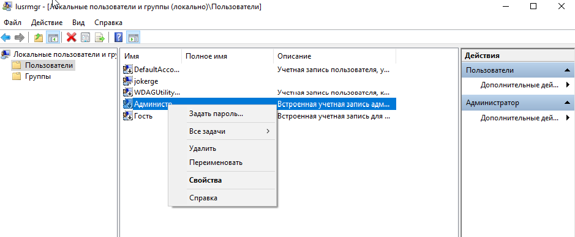
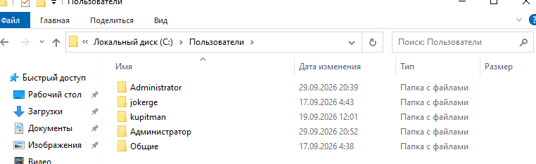

1. Меняем пароль локального админа
в cmd lusrmgr.msc

C:\Users\<Имя_пользователя>\AppData\Local\Microsoft\Credentials\ - здесь креды
Для этого выбрать в "Вид" - галочка показывать скрытые файлы и убрать галочку на Скрывать защищенные системные файлы

2. Активируем запись
там же, но в свойствах 

Из под локального админа - .\Администратор т.к. система на ру
